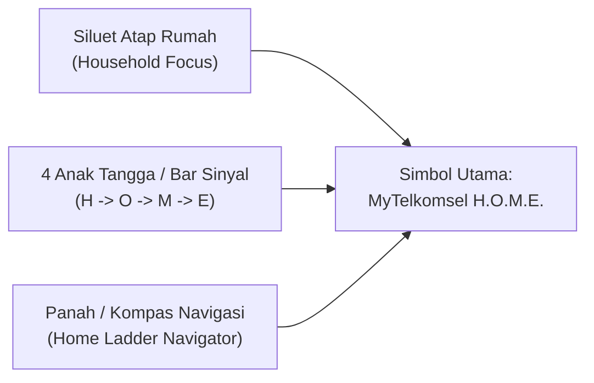

# Spesifikasi & AI Prompt Desain Logo: "MyTelkomsel H.O.M.E. (Home Ladder Navigator)"

**Nama Produk / Fitur:** **MyTelkomsel H.O.M.E.**  
**Sub-brand / Tagline:** *Home Ladder Navigator*  
**Konteks Kompetisi:** DWDG Mini Case Competition 2026 — *Optimizing Telkomsel’s Household Connectivity Portfolio*  
**Fungsi Dokumen:** Panduan identitas visual, ketentuan anatomi logo, palet warna, tipografi, dan kumpulan *prompt* siap pakai (Midjourney, Ideogram, DALL-E 3, Recraft.ai, Figma) untuk membuat logo **MyTelkomsel H.O.M.E.**

---

## 1. Filosofi & Konsep Inti Logo (*Visual Metaphor*)

Logo **MyTelkomsel H.O.M.E.** harus menggabungkan **3 elemen visual utama** dalam satu ikon modern yang minimalis (*flat/semi-3D app icon*):

1. **Siluet Atap Rumah (*Home Roof*):** Melambangkan fokus pada konektivitas rumah tangga (*Household Connectivity*).
2. **4 Anak Tangga Naik / Sinyal Bar (*4 Ascending Steps / Signal Ladder*):** Melambangkan 4 tahapan strategi **H.O.M.E.** (**H**armonize $\to$ **O**ptimize $\to$ **M**ove Up $\to$ **E**mbed) sekaligus bar sinyal internet yang makin kuat dari **Orbit** menuju **IndiHome Fiber** dan **FMC**.
3. **Jarum Kompas / Panah Navigasi (*Navigator Arrow*):** Melambangkan fungsi aplikasi sebagai *Navigator* pintar berbasis geospasial dan kuesioner yang mengarahkan rumah tangga ke produk yang tepat.



---

## 2. Ketentuan Spesifik Logo (*Brand Guidelines*)

### A. Palet Warna Resmi (*Color System*)
Mengadopsi identitas korporat **Telkomsel & IndiHome** yang dipadukan dengan aksen **Milestone Loyalty (`Bronze`, `Silver`, `Gold`)**:

| Peran Warna | Nama Warna | Kode HEX | Kode RGB | Penggunaan pada Logo & UI |
| :--- | :--- | :---: | :---: | :--- |
| **Primary Red** | *Telkomsel Crimson* | `#E60012` | `230, 0, 18` | Elemen utama atap rumah, anak tangga tertinggi, dan aksen utama logo |
| **Primary Dark** | *Deep Navy Slate* | `#0F172A` | `15, 23, 42` | Warna latar belakang gelap (*dark mode*) atau warna teks utama pada latar putih |
| **Secondary Gradient** | *Vibrant Coral-Orange* | `#FF4D00` $\to$ `#E60012` | Gradasi | Gradasi pada 4 anak tangga untuk memberi kesan pergerakan naik (*Move Up*) |
| **Orbit Accent** | *Electric Sky Blue* | `#0EA5E9` | `14, 165, 233` | Aksen khusus indikator jaringan seluler/FWA (**Telkomsel Orbit**) |
| **IndiHome Fiber Accent** | *Emerald Fiber Green* | `#10B981` | `16, 185, 129` | Aksen khusus indikator jaringan *Fiber-Ready* (**IndiHome**) |
| **Milestone Tiers** | *Bronze / Silver / Gold* | `#CD7F32` / `#CBD5E1` / `#FACC15` | Badge Khusus | Digunakan pada lencana *Milestone Loyalty* di tahap **Embed** |

### B. Tipografi (*Logotype Specification*)
- **Baris 1 (Super-App Endorsement):** `MyTelkomsel` menggunakan jenis huruf *Sans-Serif Geometric Medium* (seperti **Plus Jakarta Sans Medium**, **Poppins Medium**, atau **Telkomsel Batik Sans**).
- **Baris 2 (Nama Utama):** `H.O.M.E.` menggunakan *Sans-Serif ExtraBold / Black* dengan titik pemisah berwarna merah atau emas di antara huruf (`H • O • M • E`).
- **Baris 3 (Descriptor):** `HOME LADDER NAVIGATOR` menggunakan huruf kapital dengan jarak antarhuruf lebar (*letter-spacing: `0.15em`*, ukuran kecil).

### C. Aturan Proporsi & Variasi Logo (*Logo Lockups*)
1. **App Icon / Favicon (`1:1`):** Hanya simbol rumah + 4 anak tangga di dalam kotak bersudut membulat (*squircle* ala iOS/MyTelkomsel app icon).
2. **Horizontal Lockup (`3:1`):** Ikon di sebelah kiri + tulisan `MyTelkomsel H.O.M.E. (Home Ladder Navigator)` di sebelah kanan (untuk *header website*, *navbar* prototipe, dan pojok slide presentasi).
3. **Monochrome / White Version:** Versi putih penuh (`#FFFFFF`) untuk diletakkan di atas foto atau latar belakang merah Telkomsel.

### D. Pantangan Desain (*Do's & Don'ts*)
- **JANGAN** menggunakan ilustrasi tangga kayu/pertukangan yang terlalu harfiah (*literal ladder*). Gunakan **tangga geometris abstrak** yang menyerupai **bar sinyal Wi-Fi/seluler yang menanjak**.
- **JANGAN** menggunakan lebih dari 3 warna pada simbol utama agar logo tetap tajam saat diperkecil hingga ukuran `24x24 px`.
- **PASTIKAN** jumlah anak tangga/bar pada ikon berjumlah **tepat 4 tingkat** (mewakili **H - O - M - E**).

---

## 3. Kumpulan Prompt AI Siap Pakai (Copy-Paste)

> [!TIP]
> **Rekomendasi AI Generator Terbaik:**
> - **Ideogram 2.0**, **Recraft V3**, atau **DALL-E 3 (ChatGPT):** Sangat direkomendasikan untuk **Prompt Utama (All-in-One Brand Sheet)** di bawah ini karena mampu merender tipografi `"MyTelkomsel H.O.M.E."` sekaligus beberapa variasi logo dalam satu kanvas.
> - **Midjourney v6.1:** Terbaik untuk tekstur 3D *app icon* dan proporsi geometris.

### ⭐ PROMPT UTAMA (All-in-One Brand Identity Sheet — Semua Variasi Logo Tanpa Lencana Milestone)
Gunakan **1 prompt ini** jika kamu ingin langsung men-*generate* **seluruh variasi logo utama** (Flat Vector Icon, 3D App Icon, Horizontal Lockup dengan Tipografi, dan Monochrome Dark/Light) dalam **satu lembar *Brand Identity Sheet* sekaligus** (tanpa lencana Milestone):

> **Prompt All-in-One (Inggris — Siap Copy-Paste):**  
> `A professional corporate brand identity presentation sheet showcasing the complete logo system for a telecom super-app feature named "MyTelkomsel H.O.M.E." with subtitle "HOME LADDER NAVIGATOR". The core logo symbol cleverly combines a minimalist geometric house roofline with 4 ascending signal bars / steps inside the house (forming an upward value ladder) and a subtle compass navigation arrow at the roof peak. The presentation board is neatly organized into 3 clean sections on a split light-and-dark grid background:`  
> `1. TOP SECTION (Horizontal Brand Lockup): The flat vector geometric house-and-4-steps icon on the left, paired with bold modern sans-serif typography reading "MyTelkomsel H.O.M.E." and smaller wide-tracked subtitle "HOME LADDER NAVIGATOR" on the right, shown in both light mode (white background) and dark mode (deep navy #0F172A background).`  
> `2. BOTTOM LEFT (2D Flat Vector Symbol & Monochrome): Clean standalone flat vector SVG mark with Telkomsel crimson red (#E60012) to coral-orange (#FF4D00) gradient, sky blue (#0EA5E9), and emerald green (#10B981) accents, plus a pure white monochrome version.`  
> `3. BOTTOM RIGHT (3D Mobile App Icon): A sleek iOS squircle super-app icon (#0F172A) featuring the same house-and-4-ascending-steps symbol in glowing 3D glassmorphism with subtle studio lighting.`  
> `Clean Pentagram and McKinsey-grade tech branding board, sharp vector edges, accurate typography, no extra badges or clutter, 8k resolution, Dribbble & Behance branding showcase.`

---

### Prompt Terpisah per Komponen (Opsional — Jika Ingin Generate Satu per Satu)

#### Prompt 1 — Versi Flat Vector Minimalis (Cocok untuk Slide Deck & Header Website)
> **Prompt (Inggris):**  
> `A modern minimalist flat vector logo mark for a telecom digital product named "MyTelkomsel H.O.M.E.". The icon cleverly combines a sleek geometric house roofline with 4 ascending signal bars / steps forming an upward ladder inside the house, and a subtle compass navigation arrow at the peak. Color palette: Telkomsel crimson red (#E60012) gradient to vibrant coral orange (#FF4D00) on a clean white background. Clean geometric lines, corporate tech branding, McKinsey-grade presentation style, flat vector SVG aesthetic, Paul Rand and Pentagram design inspiration, no clutter, high contrast.`

#### Prompt 2 — Versi App Icon 3D Glassmorphism (Cocok untuk Cover Pitch Deck & Mockup HP)
> **Prompt (Inggris):**  
> `iOS app icon design for "MyTelkomsel H.O.M.E. - Home Ladder Navigator". A sleek dark navy squircle icon (#0F172A) featuring a glowing 3D glassmorphic house outline combined with 4 ascending glowing red and gold steps representing a digital value ladder and Wi-Fi signal strength. Subtle UI lighting, premium fintech/telco super-app aesthetic similar to Shopee VIP and MyTelkomsel, ultra-clean studio render, Dribbble trending UI asset, 8k resolution.`

#### Prompt 3 — Versi Horizontal Lockup dengan Tipografi (Khusus Ideogram 2.0 / Recraft V3)
> **Prompt (Inggris):**  
> `Horizontal tech logo lockup on a pure white background. On the left, a minimalist geometric icon combining a house roof and 4 ascending red signal steps (#E60012). On the right, bold modern sans-serif typography reading "MyTelkomsel H.O.M.E." in dark navy (#0F172A) and crimson red, with smaller subtitle "HOME LADDER NAVIGATOR" underneath. Clean corporate telecom branding, vector graphic, sharp edges.`

#### Prompt 4 — Lencana Milestone Loyalty (`Bronze`, `Silver`, `Gold` Badges — Terpisah Khusus Layar Embed)
> **Prompt (Inggris):**  
> `A set of 3 modern gamified loyalty tier badges for a telecom app: Bronze Starter, Silver Upgrader, and Gold Family VIP. Each badge is shaped like a sleek hexagonal shield with a minimalist house and signal ladder icon inside. Metallic bronze, brushed silver, and glowing luxury gold textures, Shopee Mall / GrabUnlimited loyalty badge style, isolated on dark background, clean UI game icon set.`

---

## 4. Kode SVG Logo Siap Pakai (Bisa Langsung Dipakai di HTML / Figma)

Jika tim membutuhkan logo vektor murni (`SVG`) yang langsung memiliki **4 anak tangga H-O-M-E** dan **atap rumah Telkomsel**, salin kode SVG berikut ke dalam file `.svg` atau langsung ke dalam kode HTML:

```xml
<svg xmlns="http://www.w3.org/2000/svg" viewBox="0 0 120 120" width="120" height="120">
  <defs>
    <linearGradient id="tselGrad" x1="0%" y1="100%" x2="100%" y2="0%">
      <stop offset="0%" stop-color="#B91C1C" />
      <stop offset="50%" stop-color="#E60012" />
      <stop offset="100%" stop-color="#FF4D00" />
    </linearGradient>
    <linearGradient id="goldGrad" x1="0%" y1="0%" x2="100%" y2="100%">
      <stop offset="0%" stop-color="#FDE047" />
      <stop offset="100%" stop-color="#EAB308" />
    </linearGradient>
  </defs>
  <!-- Background Squircle -->
  <rect x="4" y="4" width="112" height="112" rx="26" fill="#0F172A" stroke="#1E293B" stroke-width="2"/>
  <!-- House Roof & Navigator Arrow Peak -->
  <path d="M22 54 L60 22 L98 54" fill="none" stroke="url(#tselGrad)" stroke-width="8" stroke-linecap="round" stroke-linejoin="round"/>
  <!-- 4 Ascending Steps of H.O.M.E. (Harmonize -> Optimize -> Move Up -> Embed) -->
  <!-- Step 1: H (Harmonize) -->
  <rect x="28" y="76" width="12" height="18" rx="3" fill="#0EA5E9" />
  <!-- Step 2: O (Optimize) -->
  <rect x="45" y="66" width="12" height="28" rx="3" fill="#10B981" />
  <!-- Step 3: M (Move Up) -->
  <rect x="62" y="54" width="12" height="40" rx="3" fill="url(#tselGrad)" />
  <!-- Step 4: E (Embed - Gold Milestone) -->
  <rect x="79" y="42" width="12" height="52" rx="3" fill="url(#goldGrad)" />
</svg>
```
- **Makna Warna pada 4 Anak Tangga SVG di Atas:**
  1. **Bar 1 (Biru `#0EA5E9` — Harmonize):** Titik masuk fleksibel via **Telkomsel Orbit** / penempatan awal.
  2. **Bar 2 (Hijau `#10B981` — Optimize):** Optimalisasi nilai paket **IndiHome Fiber**.
  3. **Bar 3 (Merah Gradasi `#E60012` — Move Up):** Kenaikan kelas dari Orbit ke IndiHome tanpa jeda.
  4. **Bar 4 (Emas `#FACC15` — Embed):** Puncak loyalitas keluarga **Gold Family VIP (FMC)**.
