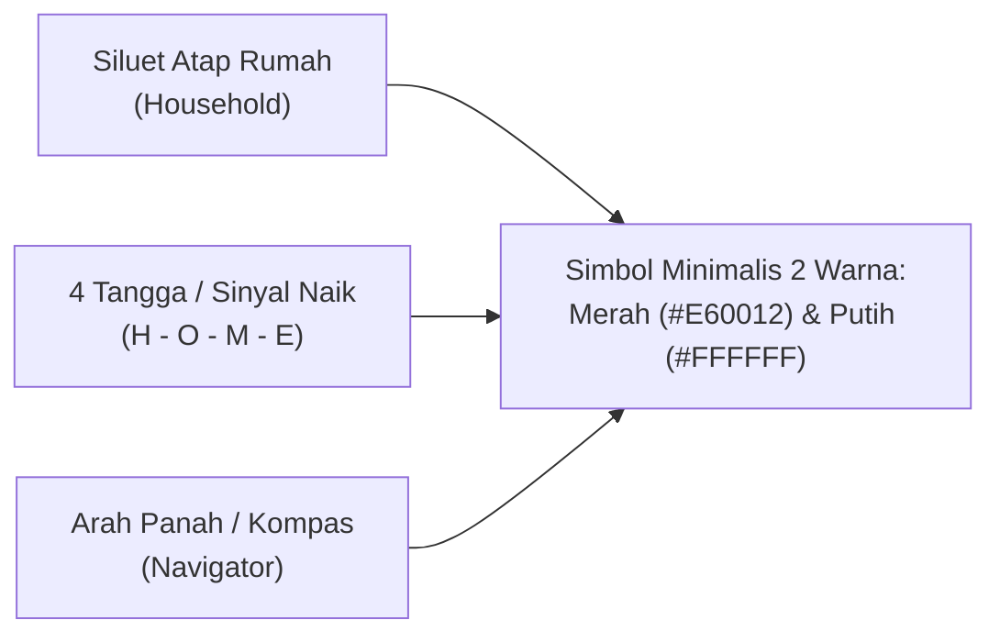

# Spesifikasi & AI Prompt Desain Logo: "MyTelkomsel H.O.M.E. (Home Ladder Navigator)"

**Nama Produk / Fitur:** **MyTelkomsel H.O.M.E.**  
**Sub-brand / Tagline:** *Home Ladder Navigator*  
**Konteks Kompetisi:** DWDG Mini Case Competition 2026 — *Optimizing Telkomsel’s Household Connectivity Portfolio*  
**Arah Estetika Utama (Revised):** **Ultra-Minimalist Red & White Corporate Tech Mark** — *Clean geometric negative space, two-tone palette (Telkomsel Crimson Red & Pure White), timeless flat vector symbol.*

---

## 1. Evaluasi & Revisi Filosofi Desain (*Why Minimalist Red & White?*)

Logo sebelumnya yang menggunakan 4 warna pelangi (biru, hijau, merah, kuning) ditambah efek 3D neon cenderung terlihat terlalu ramai (*over-designed*) dan kehilangan wibawa korporat **Telkomsel**.

Pada revisi ini, identitas visual **MyTelkomsel H.O.M.E.** difokuskan pada **Minimalisme Geometris 2 Warna Utama (Merah Telkomsel `#E60012` & Putih Bersih `#FFFFFF`)**:

1. **Aturan 2 Warna Utama (*Strict Two-Tone Discipline*):**
   - Hanya menggunakan **Telkomsel Crimson Red (`#E60012` — dengan sedikit sentuhan gradasi hangat ke `#FF2A15` jika diperlukan)** dan **Pure White (`#FFFFFF`)** (serta `#0F172A` *Deep Slate* khusus untuk teks sekunder pada latar putih).
   - Menghilangkan warna biru/hijau/kuning pada simbol utama agar logo terlihat **satu kesatuan (*cohesive*), ikonik, dan sekelas logo aplikasi global** (seperti Airbnb, Santander, atau MyTelkomsel terbaru).
2. **Permainan *Negative Space* & Geometri Tunggal (*Single Continuous Form*):**
   - Alih-alih menaruh grafik batang di dalam gambar rumah secara terpisah, **siluet atap rumah**, **4 anak tangga H.O.M.E.**, dan **arah panah navigasi** dilebur menjadi **satu kesatuan bentuk geometris minimalis**.



---

## 2. Ketentuan Palet Warna & Tipografi Minimalis

| Peran Warna | Nama Warna | Kode HEX | Penggunaan pada Logo |
| :--- | :--- | :---: | :--- |
| **Primary Brand Color** | *Telkomsel Crimson Red* | `#E60012` | Warna utama squircle aplikasi atau warna simbol utama di atas latar putih |
| **Secondary Warm Tone** | *Telkomsel Deep Ruby* | `#B9000E` | Gradasi halus satu nada (*monochromatic red gradient*) untuk dimensi elegan tanpa kesan ramai |
| **Core Contrast Color** | *Pure White* | `#FFFFFF` | Warna ruang negatif (*negative space*) simbol utama atau latar belakang bersih |
| **Typography Dark** | *Charcoal Navy* | `#0F172A` | Khusus untuk teks `MyTelkomsel` pada *horizontal lockup* berlatar putih |

---

## 3. Empat Opsi Konsep & Prompt AI Minimalis (Merah & Putih)

Berikut adalah **4 opsi konsep logo minimalis (Merah & Putih)** yang telah direvisi total agar bersih, modern, dan tidak ramai:

---

### ⭐ OPSI A: "Negative Space Red Squircle" (Rekomendasi Utama — Paling Modern & Super-App Ready)
**Konsep Visual:**  
Sebuah ikon aplikasi berbentuk *squircle* berwarna **Merah Telkomsel (`#E60012`)**. Di tengahnya terdapat **simbol putih bersih (`#FFFFFF`)** yang dibentuk dari **4 garis geometris sejajar yang menanjak** (*4 ascending white bars*) di mana bagian atas keempat garis tersebut membentuk potongan **sudut atap rumah sekaligus panah mengarah ke kanan atas**. Sangat simpel, ikonik, dan langsung terbaca bahkan di ukuran kecil.

> **Prompt Opsi A (Copy-Paste):**  
> `Ultra-minimalist flat vector app icon logo for "MyTelkomsel H.O.M.E.". A clean rounded squircle in solid Telkomsel crimson red (#E60012) centered on a pure white background. Inside the red squircle, a bold, clever pure white (#FFFFFF) geometric negative-space mark: 4 ascending vertical bars whose top edges align to form a sleek minimalist house roofline pointing upward like a subtle navigation arrow. Strictly two colors only: crimson red (#E60012) and pure white (#FFFFFF). Flat 2D vector design, Paul Rand and Pentagram branding style, Swiss grid geometry, zero clutter, no 3D neon, no extra colors, ultra-sharp edges, 8k resolution.`

---

### ⭐ OPSI B: "The Continuous Ribbon Roof & Steps" (Monoline Geometris di Atas Latar Putih)
**Konsep Visual:**  
Logo berlatar belakang **putih bersih (`#FFFFFF`)** dengan simbol garis pita tebal (*bold geometric ribbon*) berwarna **Merah Telkomsel (`#E60012`)** yang mengalir tanpa putus membentuk setengah atap rumah di sisi kiri dan bertransformasi menjadi **4 anak tangga naik (H-O-M-E)** di sisi kanan dengan ujung meruncing seperti jarum kompas.

> **Prompt Opsi B (Copy-Paste):**  
> `Minimalist flat vector logo mark on a pure white (#FFFFFF) background. A single bold geometric symbol in Telkomsel crimson red (#E60012) that seamlessly merges a clean house roof chevron on the left with 4 ascending geometric stair steps on the right, ending in a sharp upward compass arrow tip. Strictly two-tone palette: crimson red (#E60012) on pure white (#FFFFFF). Clean Swiss modernist corporate identity, inspired by Chermayeff & Geismar and Pentagram, flat vector SVG aesthetic, high contrast, negative space mastery, no shadows, no gradients, no text.`

---

### ⭐ OPSI C: "The Navigator Compass House" (Simbol Atap Kompas + 4 Sinyal Putih)
**Konsep Visual:**  
Menggabungkan **jarum kompas berbentuk atap rumah (*A-frame roof arrow*)** berwarna merah tua & merah terang Telkomsel, dengan **4 celah garis putih horizontal/diagonal (*negative space steps*)** di bagian dalamnya yang melambangkan 4 level **H.O.M.E.**

> **Prompt Opsi C (Copy-Paste):**  
> `Minimalist modern corporate logo icon for a digital home connectivity brand. A sleek geometric A-frame house silhouette shaped like an upward-pointing compass navigator arrow in solid Telkomsel crimson red (#E60012) on a pure white (#FFFFFF) background. Carved into the lower half of the red house silhouette using clean white negative space are 4 ascending minimalist signal steps. Strictly red and white color scheme, flat vector graphic, timeless fintech/telecom super-app icon, Braun and Apple minimalist design ethos, crisp geometry, no clutter.`

---

### ⭐ OPSI D: "Clean Horizontal Brand Lockup Sheet" (Ikon + Tipografi Bersih Merah-Putih untuk Pitch Deck)
**Konsep Visual:**  
Lembar *Brand Lockup* horizontal minimalis yang menampilkan **Ikon Squircle Merah-Putih** di sebelah kiri dan tipografi korporat **`MyTelkomsel H.O.M.E.`** (`HOME LADDER NAVIGATOR`) di sebelah kanan, disajikan dalam 2 versi bersih: **Light Mode (Latar Putih)** dan **Red Brand Mode (Latar Merah Telkomsel)**.

> **Prompt Opsi D (Copy-Paste):**  
> `A minimalist corporate brand identity lockup sheet split horizontally into two clean banners: top banner has a pure white (#FFFFFF) background, bottom banner has a solid Telkomsel crimson red (#E60012) background. Each banner shows a horizontal logo lockup: on the left is a simple minimalist geometric icon combining a house roofline and 4 ascending steps in negative space; on the right is clean modern geometric sans-serif typography reading "MyTelkomsel H.O.M.E." with small wide-tracked subtitle "HOME LADDER NAVIGATOR" underneath. Strictly crimson red (#E60012), pure white (#FFFFFF), and deep charcoal (#0F172A) for text on white. Flat vector Pentagram-style presentation, ultra-clean, zero rainbow colors, 8k.`

---

## 4. Kode SVG Minimalis Siap Pakai (Red & White Negative Space)

Kode SVG di bawah ini menerapkan **Opsi A (Minimalist Red & White Negative Space)** — menggunakan squircle merah khas Telkomsel (`#E60012`) dengan siluet atap rumah + 4 pilar menanjak berwarna putih bersih (`#FFFFFF`):

```xml
<svg xmlns="http://www.w3.org/2000/svg" viewBox="0 0 240 240" width="240" height="240">
  <defs>
    <linearGradient id="tselRedMin" x1="0%" y1="100%" x2="100%" y2="0%">
      <stop offset="0%" stop-color="#B9000E" />
      <stop offset="55%" stop-color="#E60012" />
      <stop offset="100%" stop-color="#FF2E1F" />
    </linearGradient>
  </defs>
  <!-- Red Squircle Base -->
  <rect x="12" y="12" width="216" height="216" rx="52" fill="url(#tselRedMin)" />
  <!-- Minimalist White House Roof + Navigator Arrow Peak -->
  <path
    d="M46 112 L120 46 L194 112"
    fill="none"
    stroke="#FFFFFF"
    stroke-width="16"
    stroke-linecap="round"
    stroke-linejoin="round"
  />
  <!-- 4 Pure White Ascending Steps (H - O - M - E) -->
  <rect x="62" y="150" width="20" height="36" rx="6" fill="#FFFFFF" fill-opacity="0.75" />
  <rect x="94" y="132" width="20" height="54" rx="6" fill="#FFFFFF" fill-opacity="0.85" />
  <rect x="126" y="112" width="20" height="74" rx="6" fill="#FFFFFF" fill-opacity="0.92" />
  <rect x="158" y="90" width="20" height="96" rx="6" fill="#FFFFFF" />
</svg>
```
