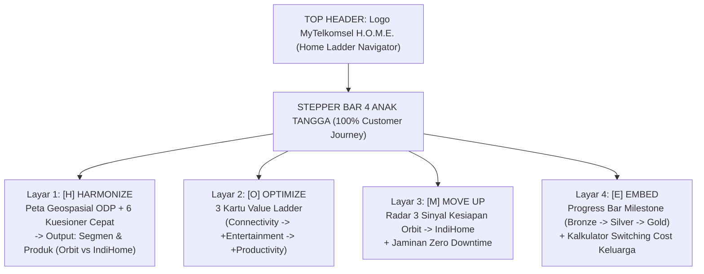

# Spesifikasi UI/UX & Panduan Desain Website/Aplikasi: "MyTelkomsel H.O.M.E. (Home Ladder Navigator)"

**Nama Produk:** **MyTelkomsel H.O.M.E. (*Home Ladder Navigator*)**  
**Bentuk Produk:** Fitur *Customer-Facing* di dalam *Super-App* **MyTelkomsel** & Portal Web Akuisisi Rumah Tangga (*100% Customer View*)  
**File Implementasi Terkait:**
- [prototype_home_ladder_navigator.html](file:///home/brenandacaesa/PROJECT/DWDG/report/prototype_home_ladder_navigator.html) *(Prototipe HTML Interaktif)*
- [Software_Proposed_Idea.md](file:///home/brenandacaesa/PROJECT/DWDG/report/Software_Proposed_Idea.md) *(Arsitektur Fungsional)*
- [LOGO_DESIGN.md](file:///home/brenandacaesa/PROJECT/DWDG/design/LOGO_DESIGN.md) *(Identitas Visual & Logo)*

---

## 1. Prinsip Utama UI/UX (*Core Design Principles*)

Agar juri lomba langsung merasakan pengalaman nyata pelanggan rumah tangga Telkomsel dalam waktu kurang dari **60 detik saat demo**, desain UI/UX fokus **100% pada *Customer View* (tanpa *Admin Dashboard*)** dengan 4 prinsip utama:

1. **Pure Super-App Customer Experience (Tanpa Admin Dashboard):**
   - Aplikasi dirancang murni dari sudut pandang pelanggan (*end-user*) di dalam **MyTelkomsel**, sehingga terasa otentik sebagai produk nyata yang siap dipakai jutaan rumah tangga.
2. **Guided Stepper Navigation (`H` $\to$ `O` $\to$ `M` $\to$ `E`):**
   - Pelanggan tidak pernah tersesat di menu yang rumit. Navigasi utama berbentuk **4 Anak Tangga Horizontal** yang selalu terlihat di bagian atas layar:
     - **[H] Harmonize:** Cek lokasi geospasial & 6 kuesioner singkat untuk mendapat rekomendasi produk yang pas.
     - **[O] Optimize:** Pilih tangga nilai (*Value Ladder*) yang sesuai kebutuhan rumah.
     - **[M] Move Up:** Pantau kesiapan naik kelas dari **Orbit** ke **IndiHome Fiber** tanpa jeda koneksi.
     - **[E] Embed:** Tautkan nomor HP keluarga & kejar **Milestone `🥉 Bronze` $\to$ `🥈 Silver` $\to$ `🥇 Gold`**.
3. **Gamified Milestone UX (Pendekatan Shopee Member):**
   - Mengganti tabel syarat & ketentuan yang membosankan menjadi **Progress Bar Interaktif (`🥉 Bronze` $\to$ `🥈 Silver` $\to$ `🥇 Gold`)** lengkap dengan indikator misi (*"1 langkah lagi ke Gold!"*) dan kalkulator **"Rugi Bersih jika Pindah ke Kompetitor"**.
4. **Zero-Friction Decision Cards:**
   - Setiap layar maksimal menampilkan **3 kartu pilihan** dengan lencana rekomendasi yang jelas (*"Paling Pas untuk Rumahmu"*).

---

## 2. Design System & UI Tokens (Tailwind CSS Ready)

### A. Skema Warna (*Color Tokens*)
Menggunakan tema **Modern Dark Slate + Telkomsel Crimson & Semantic Accents** agar peta geospasial, lencana milestone, dan indikator benefit terlihat kontras dan premium di proyektor ruang penjurian:

| Komponen UI | Kelas Tailwind CSS | Kode HEX | Fungsi Visual |
| :--- | :--- | :---: | :--- |
| **App Background** | `bg-slate-950` | `#020617` | Latar belakang utama kanvas aplikasi |
| **Card Surface** | `bg-slate-900 border-slate-800` | `#0F172A` | Kontainer kartu modul & panel simulasi |
| **Primary Brand / CTA** | `bg-rose-600 hover:bg-rose-500` | `#E11D48` / `#E60012` | Tombol aksi utama, tab aktif `H.O.M.E.` |
| **Orbit Indicator (FWA)** | `text-sky-400 bg-sky-500/10` | `#38BDF8` | Penanda produk **Telkomsel Orbit** & zona *Cellular-Only* |
| **IndiHome Indicator (FTTH)** | `text-emerald-400 bg-emerald-500/10` | `#34D399` | Penanda produk **IndiHome**, zona *Fiber-Ready*, & benefit aktif |
| **Milestone Bronze** | `text-amber-500 border-amber-500` | `#F59E0B` | Lencana & kartu **🥉 Bronze Starter** |
| **Milestone Silver** | `text-slate-200 border-slate-300` | `#E2E8F0` | Lencana & kartu **🥈 Silver Upgrader** |
| **Milestone Gold VIP** | `text-yellow-400 border-yellow-400` | `#FACC15` | Lencana & kartu **🥇 Gold Family VIP** |

### B. Tipografi & Hierarki Ukuran
- **Font Family:** `Inter` atau `Plus Jakarta Sans` (Google Fonts).
- **Heading Layar (`H1` / `H2`):** `text-xl md:text-2xl font-bold tracking-tight text-white`
- **Angka Kalkulator Benefit Rupiah:** `text-2xl font-bold tabular-nums` (menggunakan `tabular-nums` agar angka tidak bergoyang saat *slider* digeser).
- **Label & Badge Mikro:** `text-xs font-semibold uppercase tracking-wider px-2.5 py-1 rounded-full`

---

## 3. Arsitektur Layar & Wireframe Fungsional (4 Layar Customer View)

---

### Layar 1: `[H] HARMONIZE` — *Smart Geo-Placement & 6-Question Profiler*
- **Tujuan UX:** Membuktikan bahwa Orbit dan IndiHome tidak saling kanibal karena dipisahkan sejak awal oleh **data geospasial jaringan** dan **profil kebutuhan rumah tangga**.
- **Tata Letak (*2-Column Split Grid*):**
  - **Kolom Kiri (Input 7 Kolom Grid):**
    1. **Toggle Geospasial Lokasi:** 2 tombol kartu interaktif:
       - `🟢 Zona Hijau (Fiber-Ready — ODP IndiHome <150m)`
       - `🔵 Zona Biru (Cellular-Only — Jaringan 4G/5G Orbit)`
    2. **Preset Uji Cepat:** 4 tombol pil (*Flexible Starters*, *Flexible Growing*, *Stable Mainstream*, *Performance*) untuk menguji ke-4 profil rumah tangga hanya dengan 1 klik.
    3. **6 Dropdown Kuesioner Singkat:** Status hunian, durasi tinggal, jumlah orang/perangkat, aktivitas utama, tingkat kekritisan koneksi, dan layanan saat ini.
  - **Kolom Kanan (Output 5 Kolom Grid):**
    - **Kartu Hasil Rekomendasi Utama:** Menampilkan **Nama Segmen**, **Positioning Tagline**, **Rekomendasi Produk Utama** (`Telkomsel Orbit` vs `IndiHome` vs `Orbit -> Prioritas Move Up IndiHome`), dan **Catatan Geospasial Pintar** (*Geo-Override Rule*).
    - **CTA Button:** `"Lanjut ke Anak Tangga 2: OPTIMIZE →"`

---

### Layar 2: `[O] OPTIMIZE` — *Vertical Value Ladder (Tangga Nilai Paket Rumah)*
- **Tujuan UX:** Menunjukkan bagaimana pelanggan IndiHome/Orbit 1P naik ke paket bernilai lebih tinggi secara sukarela melalui 3 pilihan paket yang relevan dengan aktivitas rumah.
- **Komponen UI Utama:**
  - **Header Indikator Paket Rumah:** Menampilkan nilai langganan bulanan yang dipilih (`Rp213.500` $\to$ `Rp230.000 (+Rp16,5K)` $\to$ `Rp250.000 (+Rp36,5K)`).
  - **3 Interactive Pricing/Value Cards (3-Column Grid):**
    1. **Tangga 1 — Connectivity Only (Baseline 1P):** Harga dasar Rp213,5rb/bln (Milestone: `🥉 Bronze`).
    2. **Tangga 2 — Connectivity + Entertainment (Recommended Badge):** +Rp16,5rb/bln, dapat kecepatan ekstra + paket streaming keluarga (Naik ke Milestone: `🥈 Silver`).
    3. **Tangga 3 — Connectivity + Productivity / Gaming:** +Rp36,5rb/bln, dapat *Symmetrical Speed / Low Latency* + *Orbit Backup* (Naik ke Milestone: `🥈 Silver Plus`).

---

### Layar 3: `[M] MOVE UP` — *Orbit-to-IndiHome Graduation Radar*
- **Tujuan UX:** Memvisualisasikan keunikan terbesar strategi **H.O.M.E.** yang tidak dimiliki kompetitor—yakni memindahkan pelanggan Orbit yang sudah *outgrow* ke IndiHome secara otomatis dan tanpa putus koneksi.
- **Komponen UI Utama:**
  - **Status Pill Dinamis di Pojok Kanan Atas:** Berubah warna antara `🟢 SIAP NAIK KE INDIHOME (3/3 Sinyal Terpenuhi)` atau `🟡 TETAP DI ORBIT DULU (Tidak Dipaksa Pindah)`.
  - **3 Kartu Checkbox Sinyal Kesiapan Rumah:**
    1. `☑️ Sinyal 1 (Infrastruktur):` Lokasi rumah kini sudah terjangkau jaringan ODP IndiHome (*Fiber-Ready*).
    2. `☑️ Sinyal 2 (Usage Telemetry):` Pemakaian kuota Orbit tinggi atau sering beli *top-up* kuota tambahan.
    3. `☑️ Sinyal 3 (Tenure & Hunian):` Aktif $\ge 6\text{ bulan}$ di titik lokasi yang sama (indikasi menetap).
  - **Banner Tawaran "Naik Kelas Tanpa Jeda":** Menjelaskan bahwa internet Orbit tetap menyala sampai teknisi IndiHome selesai memasang kabel fiber, ditambah bebas biaya pasang Rp500.000 & masa loyalitas tidak hangus.

---

### Layar 4: `[E] EMBED` — *Shopee-Style Milestone Loyalty & Switching Cost Calculator*
- **Tujuan UX:** Menunjukkan bagaimana integrasi nomor HP keluarga (FMC) dan gamifikasi **Milestone (`🥉 Bronze` $\to$ `🥈 Silver` $\to$ `🥇 Gold`)** mengunci pelanggan sehingga enggan pindah ke kompetitor.
- **Komponen UI Utama:**
  1. **Milestone Progress Bar ala Shopee Member (Full-Width Top Panel):**
     - Bar progres bergradasi (`Bronze` $\to$ `Silver` $\to$ `Gold`) yang berubah panjangnya (`34%` $\to$ `68%` $\to$ `100%`) beserta teks misi dinamis.
     - **3 Kartu Tier Milestone (`🥉 Bronze Starter`, `🥈 Silver Upgrader`, `🥇 Gold Family VIP`):** Kartu yang sedang aktif menyala dengan *border* tebal bercahaya.
  2. **Panel Kiri — Slider Simulasi Anggota Keluarga (1–5 Nomor HP):**
     - Menggeser *slider* dari `1 Nomor` ke `3–5 Nomor` langsung mengubah status Milestone dari **Bronze** $\to$ **Silver** $\to$ **Gold** dan meng-update **Dompet Benefit Bulanan** (Kuota Keluarga 10–50 GB + Akses Multi-OTT + VIP Priority Care $<6\text{ jam}$).
  3. **Panel Kanan — Kalkulator "Takut Turun Kasta" (*Switching Cost / Loss Aversion Card*):**
     - Menampilkan angka besar: **Total Nilai Benefit Milestone (Rp145.000/bulan)**.
     - Menyajikan kesimpulan psikologis yang tajam: *"Jika pindah ke Wi-Fi kompetitor yang lebih murah Rp25.000/bulan, status Gold gugur dan keluarga justru **rugi bersih Rp120.000/bulan**!"*

---

## 4. Prompt Siap Pakai untuk AI UI/UX Builder (v0.dev / Lovable / Bolt / Figma)

Jika kamu atau tim ingin men-*generate* ulang atau mengembangkan tampilan UI ini di **v0 by Vercel**, **Lovable.dev**, atau **Figma AI**, salin prompt berikut:

> **Prompt UI/UX Generator (100% Customer View):**  
> `Create a modern, high-converting dark-mode interactive customer web/mobile application prototype named "MyTelkomsel H.O.M.E. (Home Ladder Navigator)" using Tailwind CSS. Focus 100% on the Customer View experience inside the MyTelkomsel super-app (no admin dashboard). Include a top header with the brand logo and a 4-step horizontal ladder navigation bar ([H] Harmonize, [O] Optimize, [M] Move Up, [E] Embed).`  
> `- In Screen 1 (Harmonize), create a split layout with a geospatial coverage toggle (Green Fiber-Ready ODP vs Blue Cellular-Only Orbit), 4 quick household profile preset buttons, and a 6-question household quiz on the left, with a dynamic segment & product recommendation card on the right.`  
> `- In Screen 2 (Optimize), display 3 interactive value-ladder pricing cards (Connectivity Only, +Entertainment, +Productivity/Gaming) with a live monthly package value indicator.`  
> `- In Screen 3 (Move Up), build a 3-signal migration readiness radar (Fiber-Ready location, high Orbit usage, >6 months tenure) with a zero-downtime Orbit-to-IndiHome upgrade offer banner.`  
> `- In Screen 4 (Embed), design a Shopee-style gamified Milestone Loyalty progress bar (Bronze Starter -> Silver Upgrader -> Gold Family VIP), an interactive slider for linked family mobile numbers (1 to 5 lines), a monthly claimable family benefit wallet, and a red "Switching Cost / Loss Aversion" calculator showing the net monthly loss in IDR if the family switches to a cheaper competitor.`  
> `Use slate-950/900 backgrounds, Telkomsel crimson (#E60012), sky-400 for Orbit, emerald-400 for IndiHome, and gold (#FACC15) for VIP milestones.`

