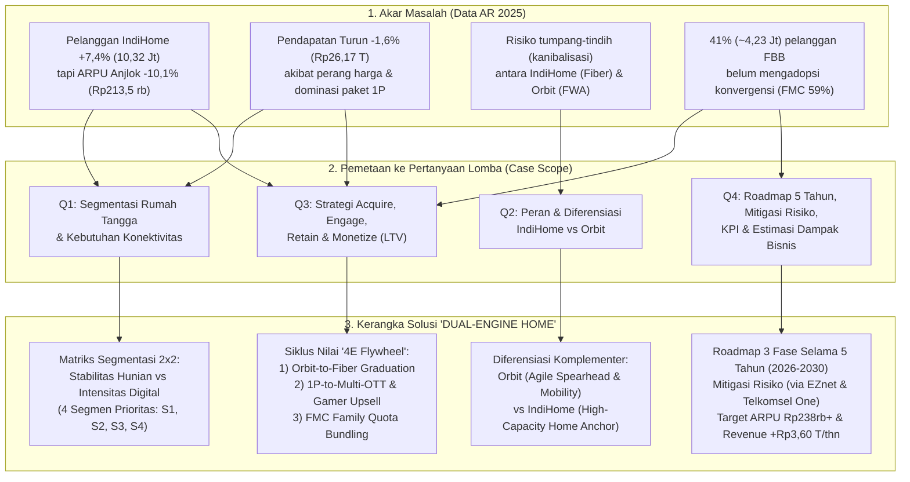
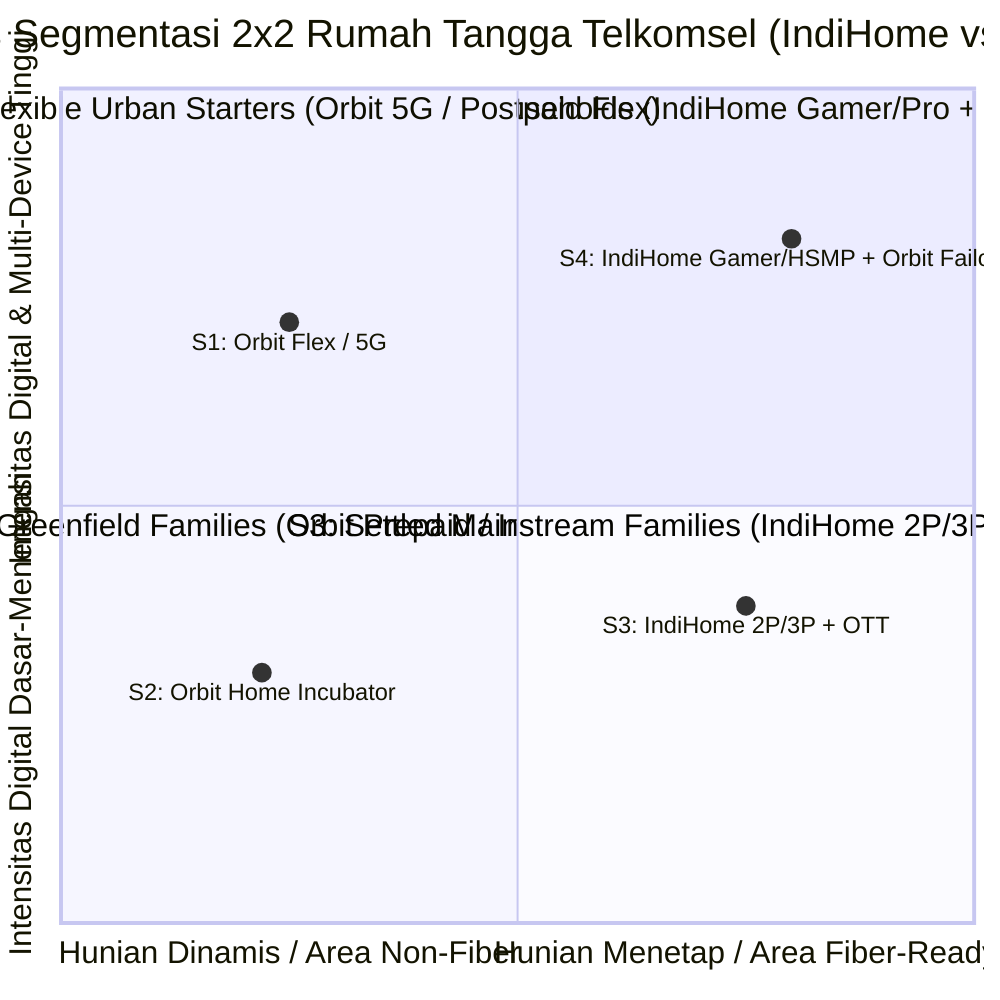
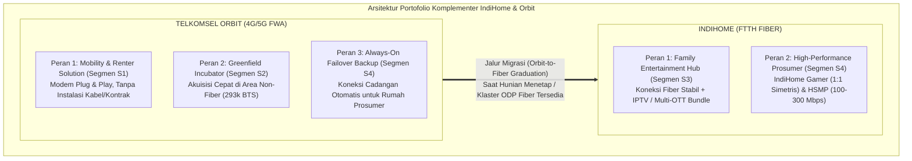

# Proposed Solution & Strategic Mapping: DWDG Mini Case Competition 2026
**Judul Strategi:** **Telkomsel "DUAL-ENGINE HOME" Architecture — *Harmonizing IndiHome Fiber & Orbit Wireless to Unlock 5-Year Household Value***  
**Disusun Berdasarkan:**
- [bedah_data_dan_masalah_dwdg.md](file:///home/brenandacaesa/PROJECT/DWDG/report/bedah_data_dan_masalah_dwdg.md)
- [DWDG Mini Case Competitoin Case.pdf](file:///home/brenandacaesa/PROJECT/DWDG/references/DWDG%20Mini%20Case%20Competitoin%20Case.pdf)
- [Annual-Report-Telkomsel-2025-web-ID.pdf](file:///home/brenandacaesa/PROJECT/DWDG/references/Annual-Report-Telkomsel-2025-web-ID.pdf)
- [Software_Proposed_Idea.md](file:///home/brenandacaesa/PROJECT/DWDG/report/Software_Proposed_Idea.md)

> [!NOTE]
> **Catatan Penyelarasan Ruang Lingkup Kasus (*Case Alignment*):**  
> Pada dokumen kasus [DWDG Mini Case Competitoin Case.pdf](file:///home/brenandacaesa/PROJECT/DWDG/references/DWDG%20Mini%20Case%20Competitoin%20Case.pdf), **EZnet sama sekali tidak disebutkan**, sedangkan **Telkomsel One** hanya disebut satu kalimat sebagai konteks di bagian *Overview* (Halaman 2), sementara *Key Question* & *Scope of the Case* (Halaman 3) secara spesifik menuntut fokus pada diferensiasi dan *positioning* dua produk utama: **IndiHome** dan **Orbit**.  
> Oleh karena itu, seluruh kerangka utama solusi ini difokuskan **100% pada sinergi IndiHome dan Orbit**, sementara **EZnet** (dari Annual Report Hal. 82 & 86) dan **Telkomsel One** ditempatkan secara strategis di bagian **Mitigasi Risiko (Bagian 4.B)** sebagai instrumen pertahanan perang harga bawah dan pengunci retensi konvergensi (FMC).

---

## 0. Peta Pemetaan Menyeluruh (*End-to-End Problem-to-Solution Mapping*)

Bagian ini memetakan secara langsung **Data & Masalah dari Annual Report 2025** $\to$ **4 Pertanyaan Kunci Casebook (Q1–Q4)** $\to$ **Solusi Strategis IndiHome & Orbit** $\to$ **Target Dampak 5 Tahun (2026–2030)**.

### Tabel Matriks Pemetaan Utama (*Master Traceability Matrix*)

|Kode|Pertanyaan Lomba (*Case Question*)|Temuan Data Annual Report 2025|Solusi yang Diajukan (*Proposed Initiative*)|Target Metrik / KPI Utama (5 Tahun)|
|:---:|:---|:---|:---|:---|
|**Q1**|Segmen rumah tangga mana yang harus diprioritaskan & apa karakteristik kebutuhannya?|Akuisisi +712 ribu pelanggan baru terdistribusi ke paket *Single-Play (1P)* murah karena pendekatan pasar yang belum terpilah tajam antara kebutuhan fleksibilitas vs kapasitas.|Matriks Segmentasi **2x2 *Residential Stability vs. Digital Intensity*** yang membagi pasar menjadi 4 segmen prioritas: **S1 (*Flexible Urban Starters*)**, **S2 (*Greenfield Families*)**, **S3 (*Settled Mainstream Families*)**, dan **S4 (*Power Prosumers/Gamers*)**.|• Akurasi penargetan mikro-area via *HomeFit & GeoPulse* • Porsi pelanggan non-1P naik dari ~32% ke **>50%**|
|**Q2**|Apa peran spesifik IndiHome dan Orbit di tiap segmen agar komplementer (bukan saling kanibalisasi)?|Telkomsel memiliki 10,32 juta IndiHome (FTTH) serta jaringan 293.136 BTS (~5.000 BTS 5G) untuk mendukung ekspansi nirkabel Orbit yang telah di-*revamp* pada 2025.|**Arsitektur Komplementer Dua Mesin + *Geo-Pricing Guardrails*:** • **Orbit:** *Agile Spearhead* (hunian sewa/dinamis S1, inkubator non-fiber S2, & *failover backup* S4). • **IndiHome:** *High-Capacity Home Anchor* (keluarga menetap S3 & *prosumer* S4).|• 0% tumpang-tindih promo di titik ODP yang sama • Utilisasi kapasitas BTS vs *port* FTTH seimbang|
|**Q3**|Bagaimana cara mengakuisisi, mengikat, menahan (*retain*), dan menaikkan nilai pelanggan tanpa perang harga?|ARPU turun -10,1% ke Rp213,5 ribu; namun trafik data tumbuh +15,0% dan penetrasi FMC baru mencapai 59% (masih ada 4,23 juta rumah tangga FBB belum konvergen).|**Siklus Nilai 4-Tahap (*4E Value Flywheel*):** 1. **Enter (*Acquire*):** *Orbit-to-Fiber Graduation Pathway* berbasis kepadatan klaster. 2. **Expand (*Engage*):** *1P-to-2P/3P STB Takeover* & *Multi-OTT Flexi Pass*. 3. **Elevate (*Monetize*):** *Usage-Triggered HSMP* & *IndiHome Gamer* (1:1 simetris). 4. **Embed (*Retain*):** Konvergensi *Fixed-Mobile* & *Early Payment Rewards*.|• Konversi >15% basis 1P ke *Add-on/2P* • Penetrasi FMC naik dari **59% ke >72%** • *Churn rate* rumah tangga turun **-45 bps**|
|**Q4**|Bagaimana rencana implementasi, mitigasi risiko, pengukuran KPI, dan estimasi dampak bisnisnya?|Pendapatan IndiHome B2C turun -1,6% (-Rp438 Miliar) ke Rp26,168 Triliun; Margin EBITDA terjaga di 45,4% berkat efisiensi biaya (-3,7% OpEx).|• **Roadmap 3 Fase Selama 5 Tahun (2026–2030)**. • **Mitigasi 5 Risiko Utama** (termasuk pengerahan **EZnet** sebagai tameng perang harga & **Telkomsel One** sebagai pengunci retensi FMC). • **Model Finansial Bottom-Up**.|• Blended ARPU pulih ke **Rp229,8rb (Thn 3)** & **Rp238,5rb (Thn 5)** • *Incremental Revenue* **+Rp3,60 T/thn** (+Rp1,63 T EBITDA)|

---

## 1. Menjawab Q1: Segmentasi Rumah Tangga Prioritas & Kebutuhan Konektivitas

Untuk menghindari jebakan komoditisasi (di mana seluruh rumah tangga hanya mencari Wi-Fi termurah), Telkomsel harus memetakan rumah tangga Indonesia menggunakan **2 dimensi struktural**:
1. **Sumbu X — Stabilitas Hunian & Kesiapan Infrastruktur Fiber (*Tenancy & Fiber Readiness*):** Apakah rumah tangga tersebut bersifat dinamis/sewa/berada di area *non-fiber* (*Greenfield*), atau menetap permanen di area yang sudah memiliki *Optical Distribution Point* (ODP) FTTH (*Brownfield/Fiber-Ready*)?
2. **Sumbu Y — Intensitas Aktivitas Digital & Nilai Ekonomi (*Household Digital Intensity*):** Apakah kebutuhan internet hanya untuk akses harian standar, atau untuk hiburan multi-layar (*streaming* 4K) hingga produktivitas kritis (*Work From Home*, *gaming* kompetitif, *live streaming*)?

### Detail Profil 4 Segmen Rumah Tangga Prioritas

| Segmen Prioritas | Profil Demografi & Hunian | Karakteristik Kebutuhan Konektivitas (*Pain Points & Needs*) | Produk Utama & Potensi ARPU |
| :--- | :--- | :--- | :---: |
| **S1. *Flexible Urban Starters*** *(Perantau, Pasangan Muda Sewa/Apartemen, Pekerja Komuter)* | • Usia 20–32 tahun, tinggal di kos eksklusif, apartemen sewa, atau kontrakan. • Pindah hunian tiap 6–24 bulan. • 1–3 pengguna per hunian (2–5 *devices*). | • **Anti-Ribet & Anti-Kontrak Panjang:** Tidak diizinkan pemilik bangunan melubangi tembok untuk kabel fiber, serta menghindari penalti putus kontrak IndiHome 12 bulan. • Butuh aktivasi instan (*plug-and-play*) yang bisa dibawa pindah tempat tinggal. | **Telkomsel Orbit (Postpaid / 5G Flex)** *ARPU: Rp135.000 – Rp210.000 / bln* |
| **S2. *Greenfield & Semi-Urban Families*** *(Keluarga di Area Belum Terjangkau Fiber / ODP Penuh)* | • Keluarga menetap di pinggiran kota (*suburban*) atau kota Tier-2/Tier-3. • 3–5 anggota keluarga. • Saat ini mengandalkan *tethering* HP yang boros kuota. | • **Akses Wi-Fi Rumah Terjangkau & Fleksibel:** Belum ada jaringan kabel FTTH di jalan rumah mereka. • Membutuhkan kuota bersama untuk sekolah anak, media sosial, dan *streaming* dengan opsi isi ulang (Prabayar) sesuai arus kas bulanan. | **Telkomsel Orbit (Prepaid Incubator)** $\to$ *Target Migrasi IndiHome* *ARPU: Rp100.000 – Rp175.000 / bln* |
| **S3. *Settled Mainstream Families*** *(Keluarga Inti Menetap di Area Fiber-Ready)* | • Keluarga mapan di perumahan *fiber-ready* (4–6 anggota keluarga, 6–10 *devices*). • Banyak yang saat ini berlangganan IndiHome 1P (30–50 Mbps) + beli pulsa seluler terpisah. | • **Hiburan Keluarga & Penghematan Tagihan Gabungan:** Koneksi stabil tanpa FUP ketat untuk TV ruang keluarga + HP seluruh anggota rumah. • Mengalami *subscription fatigue* (lelah membayar tagihan Wi-Fi, kuota 4 HP, dan 2–3 aplikasi OTT secara terpisah). | **IndiHome 2P/3P (*Multi-OTT & FMC Bundle*)** *ARPU: Rp240.000 – Rp350.000 / bln* |
| **S4. *Power Households: Prosumers & Gamers*** *(WFH Eksekutif, Content Creator, Gamer, Smart Home)* | • Rumah tangga berdaya beli menengah-atas di perkotaan. • >10 perangkat terhubung simultan (PC/konsol *gaming*, *smart TV* 4K, CCTV/IoT). | • **Performa Ekstrem & *Zero Downtime*:** Menuntut *bandwidth* besar (100–300+ Mbps), latensi sangat rendah (*low ping*), kecepatan *upload* setara *download* (simetris 1:1), serta koneksi cadangan (*failover*) jika kabel fiber mengalami gangguan. | **IndiHome Gamer / HSMP + Orbit Always-On Backup** *ARPU: Rp375.000 – Rp650.000+ / bln* |

---

## 2. Menjawab Q2: Peran & Diferensiasi Portofolio (IndiHome vs. Orbit)

Sesuai ekspektasi kasus, **IndiHome dan Orbit tidak boleh diperlakukan sebagai produk yang saling menggantikan (*interchangeable*)**. Keduanya harus diposisikan secara **komplementer berdasarkan kesiapan infrastruktur, siklus hidup hunian, dan fungsi jaringan**:

### Matriks Diferensiasi Tegas IndiHome vs. Orbit

| Dimensi Diferensiasi | **Telkomsel Orbit (4G/5G FWA)** | **IndiHome (FTTH Fiber)** | **Aturan Batas (*Portfolio Guardrails*)** |
| :--- | :--- | :--- | :--- |
| **Proposisi Nilai Utama (*Core Positioning*)** | **"*Instant & Movable Home Wi-Fi*"** — Kebebasan internet rumah instan di mana saja tanpa kabel dan tanpa ikatan kontrak jangka panjang. | **"*Unlimited Digital Home Experience*"** — Pusat konektivitas fiber berkapasitas tinggi, hiburan keluarga multi-layar, dan *gaming* tanpa batas. | Kampanye pemasaran Orbit dilarang menggunakan narasi "pengganti fiber murah"; Orbit fokus pada **kepraktisan, mobilitas, dan akses instan**. |
| **Target Segmen Utama** | • **S1 (*Flexible Starters*)** & **S2 (*Greenfield Families*)**. • *Add-on failover backup* untuk **S4 (*Power Households*)**. | • **S3 (*Settled Mainstream Families*)** & **S4 (*Power Households*)**. | **Geo-Matching di Aplikasi:** Di titik koordinat yang *ODP Fiber-Ready* untuk rumah tapak permanen, sistem memprioritaskan IndiHome. Orbit ditawarkan jika status hunian "Sewa/Kos" atau ODP penuh/belum tersedia. |
| **Struktur Produk & Pembayaran** | • Berbasis **Kuota Besar (Data Pack)** dengan opsi **Prabayar** (fleksibel) & **Pascabayar**. • Pembelian/sewa modem mandiri (*self-install*). | • Berbasis **Kecepatan (Speed-Tiered 50–300+ Mbps)** dengan kuota *unlimited* (FUP longgar), **Pascabayar Bulanan**. • Instalasi teknisi + ONT + *Smart STB*. | **Arsitektur Harga per GB:** Harga efektif per GB pada paket kuota besar Orbit dijaga lebih tinggi daripada biaya per GB *unlimited* IndiHome, sehingga pengguna berat (>400 GB/bulan) secara ekonomi selalu lebih untung bermigrasi ke IndiHome. |
| **Peran terhadap Kapasitas Jaringan** | Memonetisasi kapasitas *idle* 293.136 BTS (termasuk ~5.000 BTS 5G) di luar jam sibuk seluler dan menjadi **radar permintaan (*demand sensor*)** sebelum investasi kabel fiber. | Memaksimalkan utilisasi *homepass* & *port* FTTH TelkomGroup yang memiliki biaya marjinal per GB sangat rendah dan stabilitas tinggi. | Di sel BTS yang sudah padat (*high congestion*), penjualan Orbit dibatasi secara otomatis dan diarahkan ke instalasi fiber IndiHome. |

---

## 3. Menjawab Q3: Strategi Siklus Pelanggan (*Acquire, Engage, Retain & Monetize*)

Untuk memulihkan ARPU IndiHome dari **Rp213,5 ribu** tanpa menaikkan harga dasar secara paksa (yang justru memicu *churn*), kami merancang **"4E Value Flywheel"** (*Enter, Expand, Elevate, Embed*):

### Pilar 1: *ENTER (Smart Acquisition & "Orbit-to-Fiber Graduation Pathway")*
Mengubah Orbit dari sekadar produk terpisah menjadi **mesin akuisisi awal (*feeder*) bagi IndiHome**:
1. **Akuisisi Berbasis *AI Micro-Area Demand Sensing*:**
   - Memanfaatkan data *payload* seluler (+15% YoY di 2025) dari 156,1 juta pelanggan seluler untuk mendeteksi rumah tangga yang melakukan *tethering* berat di malam hari namun belum berlangganan IndiHome.
   - Jika rumah tersebut berada di area *Fiber-Ready* $\to$ kirim penawaran personal **IndiHome**.
   - Jika berada di area *Non-Fiber* atau terdeteksi sebagai hunian sewa/apartemen mahasiswa $\to$ tawarkan **Telkomsel Orbit**.
2. **Mekanisme *"Orbit-to-Fiber Graduation"* (Jalur Migrasi Berjenjang):**
   - Ketika sebuah klaster perumahan pengguna Orbit telah mencapai kepadatan tertentu (misal $\ge 25$ pengguna Orbit aktif dalam satu RW) dan jaringan FTTH IndiHome resmi digelar ke area tersebut, pelanggan Orbit mendapatkan undangan eksklusif **"Upgrade ke Fiber Tanpa Biaya Pasang"**.
   - **Sirkularitas Perangkat (Sinergi ESG AR Hal. 162):** Teknisi memasang IndiHome FTTH sekaligus mengambil kembali modem Orbit lama untuk **direkondisi (*refurbished*)** dan disewakan/dijual terjangkau ke pelanggan Orbit baru di area *greenfield* berikutnya! Pelanggan yang migrasi mendapat bonus kecepatan *double speed* selama 3 bulan pertama.

### Pilar 2: *EXPAND (Engagement — Mengubah Pelanggan 1P menjadi Multi-Layanan)*
Akar masalah turunnya ARPU 2025 (-10,1%) adalah membesarnya porsi pelanggan *Single-Play (1P)*. Solusinya adalah **bundling gaya hidup digital yang fleksibel**:
1. **Program *"1P-to-Entertainment" via Set-Top Box (STB) Takeover & Multi-OTT Flexi Pass*:**
   - Mengoptimalkan inisiatif **Multi-OTT Soft Bundle & STB Takeover** (AR Hal. 85). Pelanggan IndiHome 1P cukup menambah **Rp35.000 – Rp45.000/bulan** untuk menyulap TV biasa menjadi *Smart Entertainment Hub* dan bebas memilih **3 dari 8 aplikasi OTT utama** (Netflix, Disney+, Vidio, Viu, WeTV, iQIYI, Vision+ Premium, Prime Video) yang bisa diganti tiap kuartal di MyTelkomsel.
   - Bagi pelanggan, menambah Rp40.000 di tagihan IndiHome jauh lebih hemat daripada berlangganan 2–3 aplikasi OTT secara eceran (~Rp120.000/bulan). Bagi Telkomsel, ini langsung menaikkan ARPU 1P dari Rp200.000 menjadi **Rp240.000+ (+20% ARPU uplift)**!
2. **Aktivasi Konten & Auto-Renewal untuk Pengguna Orbit (*Orbit Lifestyle Pack*):**
   - Setiap pembelian paket data bulanan Orbit $\ge 150\text{ GB}$ dengan *auto-renewal* di MyTelkomsel otomatis menyertakan bonus kuota *streaming* malam dan akses *soft-bundle* Vidio/Viu/Shortmax untuk menjaga keaktifan kartu Orbit Prabayar.

### Pilar 3: *ELEVATE (Monetization — Upselling Kecepatan & Segmen Niche Bernilai Tinggi)*
Mengangkat ARPU pelanggan menengah-atas melalui diferensiasi kualitas teknis yang tidak bisa ditiru kompetitor FBB murah:
1. **Kontekstual *Higher Speed More Price (HSMP)* Berbasis AI:**
   - Saat sistem jaringan mendeteksi *bandwidth* rumah pelanggan penuh (misal >8 perangkat aktif bersamaan dan trafik jenuh di jam 19.00–22.00), MyTelkomsel mengirimkan notifikasi *real-time*: *"Koneksi rumah Anda sedang digunakan oleh 9 perangkat. Aktifkan Boost 100 Mbps hari ini atau upgrade permanen via program HSMP hanya +Rp30.000/bulan."*
2. **Ekspansi **IndiHome Gamer** & **Hybrid Prosumer Tier**:**
   - Memperluas **IndiHome Gamer** (AR Hal. 82) yang menawarkan **rasio *upload:download* simetris 1:1**, jalur *routing* prioritas berlatensi rendah, dan *voucher* bulanan **Dunia Games**.
   - Meluncurkan paket hibrida **"IndiHome Pro + Orbit Always-On Backup"** untuk segmen **S4 (*Power Households / WFH*)**: koneksi utama menggunakan Fiber IndiHome 100–300 Mbps, dilengkapi modem Orbit yang otomatis aktif (*auto-failover*) jika terjadi gangguan fisik kabel fiber di lapangan.

### Pilar 4: *EMBED (Retention & Lock-In — Konvergensi Fixed-Mobile & Loyalitas)*
Pelanggan *Single-Play (1P)* sangat mudah pindah ke kompetitor hanya karena selisih harga Rp20.000. Sebaliknya, rumah tangga yang seluruh anggotanya terikat dalam ekosistem **Fixed-Mobile Convergence (FMC)** memiliki *switching cost* yang sangat tinggi:
1. **Konversi 41% (~4,23 Juta) Pelanggan IndiHome Non-FMC melalui *Family Quota Sharing*:**
   - Pelanggan IndiHome maupun Orbit Pascabayar dapat mendaftarkan hingga **4 nomor seluler Telkomsel anggota keluarganya** di aplikasi **MyTelkomsel** untuk mendapatkan **Kuota Keluarga Bersama (25–50 GB/bulan)** hanya dengan tambahan **Rp45.000 – Rp65.000/bulan** dalam satu tagihan terpadu.
2. **Program *Early Payment & Tenure Loyalty* (AR Hal. 82 & 86):**
   - Pelanggan yang membayar tagihan lebih awal (*early payment*) atau mengaktifkan *auto-debit* di MyTelkomsel mendapat *reward* instan berupa *Speed Boost* akhir pekan atau tambahan kuota keluarga, menjaga arus kas dan menekan *churn*.

---

## 4. Menjawab Q4: Roadmap 5 Tahun, Mitigasi Risiko (EZnet & Telkomsel One), KPI & Dampak Bisnis

### A. Peta Jalan Implementasi 5 Tahun (*5-Year Implementation Roadmap: 2026–2030 dalam 3 Fase*)

Sesuai perencanaan jangka panjang, eksekusi dibagi menjadi **3 Fase Strategis yang direntangkan selama 5 Tahun (2026–2030)**. Visualisasi Gantt Chart resolusi tinggi juga telah disimpan di [`./figure/gantt_chart_5_years.png`](file:///home/brenandacaesa/PROJECT/DWDG/figure/gantt_chart_5_years.png):

| Fase Strategis (Rentang Waktu) | Fokus Eksekusi Utama | Target Capaian (*Key Milestones*) |
| :--- | :--- | :--- |
| **FASE 1: *Foundation & Portfolio Realignment*** **Tahun 1 – Tahun 2 (2026 – 2027)** | • **1.1** Integrasi *Geo-Matching* mikro-area untuk memisahkan penawaran IndiHome vs Orbit. • **1.2** Peluncuran fitur pencocokan cerdas **HomeFit Matchmaker** di aplikasi MyTelkomsel. • **1.3** Standardisasi paket Orbit (Prabayar/Pascabayar) & akuisisi *Greenfield* di area non-fiber. • **1.4** Rollout kampanye *Multi-OTT Flexi Pass* & *STB Takeover* untuk mengonversi pelanggan 1P. | • *Zero overlap* promosi IndiHome vs Orbit di titik ODP yang sama. • Penurunan ARPU berhenti dan berbalik naik ke **~Rp218.000 (2026)** dan **~Rp224.000 (2027)**. • 100.000+ rumah tangga Orbit klaster padat siap dimigrasikan. |
| **FASE 2: *Migration & Monetization Scale-Up*** **Tahun 2 – Tahun 3,5 (H2 2027 – H1 2029)** | • **2.1** Eksekusi masif program **Orbit-to-Fiber Graduation** di klaster padat Orbit yang mulai dimasuki jaringan FTTH. • **2.2** Implementasi penawaran *upselling* kecepatan kontekstual berbasis AI (**AI-HSMP**). • **2.3** Ekspansi nasional paket **IndiHome Gamer (1:1 Simetris)** & *Prosumer WFH Tier*. • **2.4** Operasionalisasi sirkularitas rekondisi modem Orbit lama untuk ekspansi ke kota Tier-2/Tier-3. | • Porsi pelanggan non-1P (2P/3P/Add-on) menembus **>45%** dari total basis IndiHome. • *Blended ARPU* mencapai **~Rp230.000/bulan**. • Penghematan CapEx modem Orbit hingga 35% lewat skema rekondisi (*refurbished*). |
| **FASE 3: *Ecosystem Maturity & Value Lock-In*** **Tahun 4 – Tahun 5 (2029 – 2030)** | • **3.1** Komersialisasi penuh paket hibrida **"IndiHome Fiber + Orbit 5G Always-On Backup"** untuk segmen *Power Households*. • **3.2** Ekspansi *Next-Gen Orbit 5G FWA* berkapasitas tinggi & integrasi *Smart Home IoT*. • **3.3** Optimasi *Preventative Churn AI* & audit nilai jangka panjang (*Customer Lifetime Value*). | • Penetrasi konvergensi rumah tangga mencapai **>72%**. • *Blended ARPU* jangka panjang stabil di **Rp238.000+ / bulan** (pulih melampaui level 2024). • Penurunan *churn rate* struktural sebesar **-45 bps**. |

---

### B. Matriks Risiko & Mitigasi (*Risk & Mitigation Measures — Peran Strategis EZnet & Telkomsel One*)

Di bagian inilah temuan mendalam dari **Annual Report Telkomsel 2025** mengenai **EZnet / EZnet Wireless** (Hal. 63, 82, 86) dan **Telkomsel One** (Hal. 66, 82, 86) digunakan sebagai **senjata mitigasi risiko struktural** untuk melindungi strategi utama IndiHome dan Orbit:

| Risiko Potensial | Tingkat Risiko | Dampak jika Terjadi | Strategi Mitigasi (Memanfaatkan Kapabilitas Ekosistem Telkomsel) |
| :--- | :---: | :--- | :--- |
| **1. Risiko Perang Harga Ekstrem di Segmen Bawah & Dilusi Brand IndiHome/Orbit** | **Tinggi** | Kompetitor FBB murah / RT-RW Net memicu perang tarif di bawah Rp150.000; jika IndiHome atau Orbit ikut menurunkan harga, *blended ARPU* akan makin hancur. | **Mitigasi via *Fighting Brand* "EZnet & EZnet Wireless" (AR Hal. 82 & 86):** • IndiHome dan Orbit **dilarang** memangkas harga untuk bertarung di segmen ultra-murah. • Sebagai gantinya, Telkomsel mengerahkan **EZnet** (fiber *entry-level* 10 Mbps) dan **EZnet Wireless** (*Unlimited FUP* + sewa alat/BYOD) khusus di zona merah perang harga sebagai "perisai pelindung" (*flanker brand*), sehingga ekuitas merek & ARPU IndiHome serta Orbit tetap terjaga di level menengah-atas. |
| **2. Risiko *Churn* Pelanggan 1P & Rendahnya *Switching Cost* Rumah Tangga** | **Tinggi** | Pelanggan IndiHome 1P atau Orbit Prabayar mudah berpindah ke ISP lain ketika ada promo diskon musiman kompetitor. | **Mitigasi via Ekosistem FMC "Telkomsel One" (AR Hal. 66 & 82):** • Mengikat pelanggan IndiHome dan Orbit ke dalam paket konvergensi **Telkomsel One (Personal & Family Plan)** di aplikasi **MyTelkomsel** yang menggabungkan internet rumah (IndiHome/Orbit) + kuota seluler keluarga (Halo+/SIMPATI) dalam satu tagihan. • Ketika 3–4 nomor HP anggota keluarga sudah terhubung ke kuota bersama rumah, *switching cost* menjadi sangat tinggi dan *churn rate* terbukti turun hingga **>50%**. |
| **3. Risiko Kanibalisasi Internal antara IndiHome dan Orbit** | **Tinggi** | Pelanggan di area yang sudah ada kabel fiber IndiHome justru memilih Orbit karena menganggapnya setara, sehingga *port* ODP FTTH menganggur. | **Mitigasi via *Geo-Fencing* ("HomeFit") & Arsitektur Tarif per GB:** • Di koordinat *ODP Fiber-Ready* untuk hunian tetap, sistem penjualan digital mengunci rekomendasi utama pada IndiHome. • Tarif efektif per GB Orbit diset di atas tarif *unlimited fiber*, sehingga untuk pemakaian keluarga berat (>400 GB/bulan), IndiHome selalu lebih ekonomis. |
| **4. Risiko Kongesti Trafik BTS Seluler Akibat Pengguna Orbit** | **Sedang - Tinggi** | Pemakaian kuota rumah tangga Orbit di jam puncak (19.00–22.00) membebani kapasitas BTS 4G/5G dan menurunkan kualitas sinyal pengguna HP. | **Mitigasi via *Dynamic Cell-Load Cap* & Migrasi ke Fiber:** • Penjualan modem Orbit baru dibatasi otomatis pada *sector* BTS yang utilisasinya sudah melewati $65\%$. • Klaster BTS yang padat akibat pengguna Orbit langsung diprioritaskan dalam program **Orbit-to-Fiber Graduation** untuk memindahkan trafik dari udara (BTS) ke kabel (FTTH). |
| **5. Risiko Beban Subsidi Perangkat (Modem Orbit & STB) terhadap Margin EBITDA** | **Sedang** | Biaya pengadaan perangkat baru menekan profitabilitas jika pelanggan berhenti berlangganan sebelum masa balik modal (*payback period*). | **Mitigasi via *Circular Device Economy* (AR Hal. 162):** • Memanfaatkan fasilitas rekondisi modem Telkomsel (yang pada 2025 telah berhasil merekondisi puluhan ton perangkat rumah tangga) untuk memutar kembali modem Orbit eks-migrasi ke pelanggan baru di kota Tier-2/3, menghemat CapEx perangkat hingga **35%–40%**. |

---

### C. Indikator Kinerja Utama 5 Tahun (*5-Year Measurable KPIs Scorecard*)

| Kategori Metrik | Indikator Kinerja Utama (KPI) | Baseline (AR 2025) | Akhir Fase 1 (Thn 2 / 2027) | Akhir Fase 2 (Thn 3,5 / 2029) | Akhir Fase 3 (Thn 5 / 2030) |
| :--- | :--- | :---: | :---: | :---: | :---: |
| **Monetisasi & Nilai** | **ARPU IndiHome B2C (Blended)** | Rp213,5 ribu | **Rp224,0 ribu (+4,9%)** | **Rp229,8 ribu (+7,6%)** | **Rp238,5 ribu (+11,7%)** |
| **Komposisi Portofolio** | **Porsi Pelanggan Non-1P Murni (2P/3P/Add-on)** | ~32% (Estimasi) | **40%** | **46%** | **52%** |
| **Skala Pelanggan** | **Total Pelanggan IndiHome B2C** | 10,324 Juta | **10,97 Juta** | **11,45 Juta** | **12,00 Juta** |
| **Sinergi Orbit $\to$ Fiber** | **Akumulasi Migrasi *Orbit-to-IndiHome*** | Belum terstruktur | **100.000 Rumah** | **250.000 Rumah** | **450.000 Rumah** |
| **Konvergensi (FMC)** | **Penetrasi FMC terhadap Basis Rumah Tangga** | 59% (~6,09 Jt) | **65%** | **68%** | **73%** |
| **Retensi Pelanggan** | **Penurunan *Monthly Churn Rate* Rumah Tangga** | Baseline 2025 | **-20 bps** | **-35 bps** | **-45 bps** |

---

### D. Estimasi Dampak Bisnis (*Simplified Business Impact Estimation*)

Menggunakan angka resmi **Annual Report Telkomsel 2025** sebagai *baseline* (**10,324 juta pelanggan IndiHome B2C**, **ARPU Rp213,5 ribu/bulan**, **Pendapatan Rp26,168 triliun/tahun**, dan **Margin EBITDA 45,4%**), berikut adalah rincian dampak finansial tahunan (*annualized run-rate*) ketika strategi mencapai skala penuh pada Fase 2–3:

| Pendorong Nilai (*Value Driver*) | Asumsi Operasional Konservatif & Realistis | Perhitungan Dampak Tahunan | Dampak Pendapatan Tahunan (*Incremental Revenue*) |
| :--- | :--- | :--- | :---: |
| **1. *Upselling* Basis 1P ke Multi-OTT / HSMP / Gamer** *(Pilar Expand & Elevate)* | **15%** dari basis pelanggan awal (~1,55 juta rumah tangga) mengambil paket *Multi-OTT Flexi Pass*, *HSMP*, atau *IndiHome Gamer* dengan tambahan rata-rata **+Rp35.000/bulan**. | $1.550.000 \times \text{Rp35.000} \times 12\text{ bln}$ | **+Rp651 Miliar / tahun** |
| **2. Ekspansi Konvergensi FMC (*Family Quota Bundling*)** *(Pilar Embed & Mitigasi Churn)* | Tambahan **+9% basis pelanggan (~930.000 rumah tangga baru)** mengaktifkan *Family Quota Share* dengan tambahan belanja bersih rumah tangga **+Rp45.000/bulan**. | $930.000 \times \text{Rp45.000} \times 12\text{ bln}$ | **+Rp502 Miliar / tahun** |
| **3. Penghematan Pendapatan dari Penurunan *Churn*** *(Efek Retensi FMC & Early Payment)* | Retensi membaik sehingga **1,75%** basis pelanggan (~180.000 rumah tangga/tahun) yang seharusnya *churn* berhasil dipertahankan pada ARPU Rp213.500/bulan. | $180.000 \times \text{Rp213.500} \times 12\text{ bln}$ | **+Rp461 Miliar / tahun** *(Pendapatan terselamatkan)* |
| **4. Pertumbuhan Akuisisi Selektif & *Orbit-to-Fiber Graduation*** *(Pilar Enter)* | Penambahan bersih rata-rata **+650.000 pelanggan berkualitas** (gabungan ekspansi selektif + migrasi klaster Orbit) dengan ARPU rata-rata paket baru **Rp235.000/bulan**. | $650.000 \times \text{Rp235.000} \times 12\text{ bln}$ | **+Rp1.833 Miliar / tahun** |
| **5. Monetisasi Mandiri Orbit** *(Prepaid-to-Postpaid, Auto-Renewal & Backup Add-on)* | Dari estimasi ~1,2 juta pengguna aktif Orbit, **30%** (~360.000 rumah tangga) beralih ke paket *Auto-Renewal / Postpaid / Hybrid Backup* dengan kenaikan belanja **+Rp35.000/bulan**. | $360.000 \times \text{Rp35.000} \times 12\text{ bln}$ | **+Rp151 Miliar / tahun** |
| **TOTAL INCREMENTAL HOUSEHOLD REVENUE & EBITDA** | Dengan **Margin EBITDA Telkomsel 45,4%** (AR 2025 Hal. 157), tambahan pendapatan rumah tangga sebesar **+Rp3,60 Triliun/tahun** menghasilkan tambahan EBITDA sekitar **+Rp1,63 Triliun/tahun** (atau **~Rp18,0 Triliun akumulasi pendapatan tambahan selama 5 tahun**). | $\text{Rp3,60 Triliun} \times 45,4\%$ | **+Rp3,60 Triliun / thn Revenue** *(+Rp1,63 Triliun / thn EBITDA)* |
