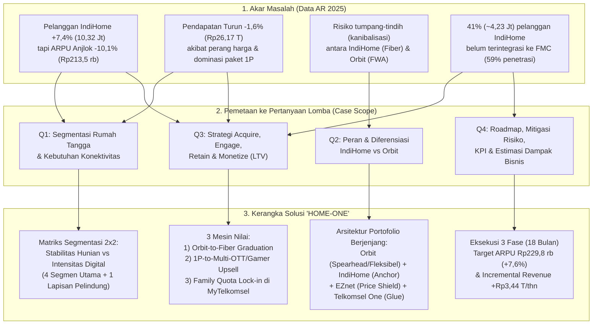
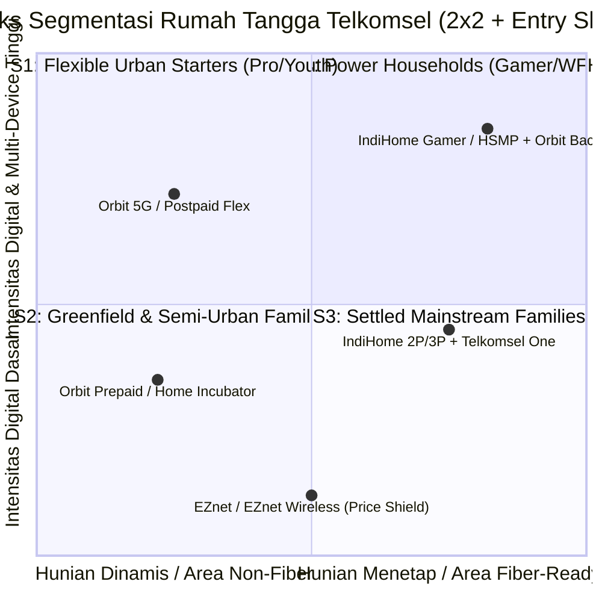
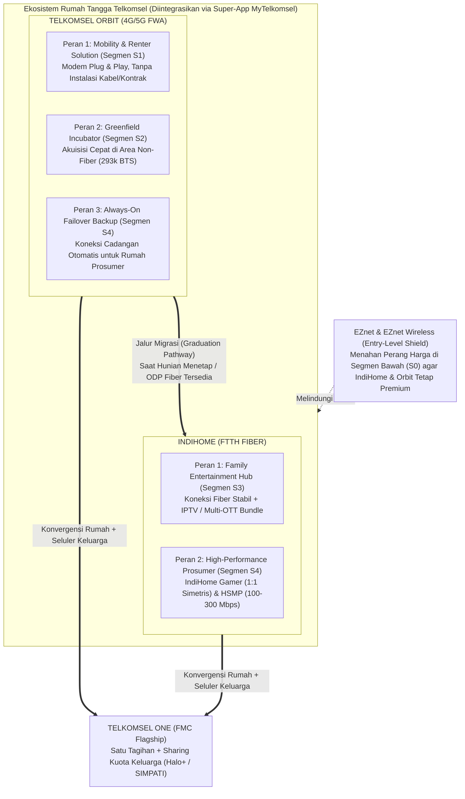
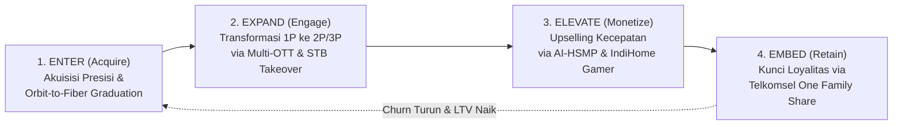

# Proposed Solution & Strategic Mapping: DWDG Mini Case Competition 2026
**Judul Strategi:** ** Telkomsel "HOME-ONE" Architecture — *Harmonizing Fiber & Wireless to Unlock Long-Term Household Value* **  
**Disusun Berdasarkan:**
- [bedah_data_dan_masalah_dwdg.md](file:///home/brenandacaesa/PROJECT/DWDG/report/bedah_data_dan_masalah_dwdg.md)
- [DWDG Mini Case Competitoin Case.pdf](file:///home/brenandacaesa/PROJECT/DWDG/references/DWDG%20Mini%20Case%20Competitoin%20Case.pdf)
- [Annual-Report-Telkomsel-2025-web-ID.pdf](file:///home/brenandacaesa/PROJECT/DWDG/references/Annual-Report-Telkomsel-2025-web-ID.pdf)

---

## 0. Peta Pemetaan Menyeluruh (*End-to-End Problem-to-Solution Mapping*)

Bagian ini memetakan secara langsung **Data & Masalah dari Annual Report 2025** $\to$ **4 Pertanyaan Kunci Casebook (Q1–Q4)** $\to$ **Solusi Strategis** $\to$ **Target Dampak Kuantitatif**.

### Tabel Matriks Pemetaan Utama (*Master Traceability Matrix*)

|Kode|Pertanyaan Lomba (*Case Question*)|Temuan Data Annual Report 2025|Solusi yang Diajukan (*Proposed Initiative*)|Target Metrik / KPI Utama|
|:---:|:---|:---|:---|:---|
|**Q1**|Segmen rumah tangga mana yang harus diprioritaskan & apa karakteristik kebutuhannya?|Akuisisi +712 ribu pelanggan baru terdistribusi ke paket *Single-Play (1P)* murah karena pendekatan pasar yang belum terpilah tajam antara kebutuhan fleksibilitas vs kapasitas.|Matriks Segmentasi **2x2 *Residential Stability vs. Digital Intensity*** yang membagi pasar menjadi 4 segmen prioritas (**S1 *Flexible Starters***, **S2 *Greenfield Families***, **S3 *Connected Living Families***, **S4 *Power Prosumers/Gamers***) + **S0 (*Price-Sensitive Shield*)**.|• Akurasi penargetan mikro-area via *Hitakari AI* • Porsi akuisisi non-1P naik dari <30% ke **>45%**|
|**Q2**|Apa peran spesifik IndiHome dan Orbit di tiap segmen agar komplementer (bukan saling kanibalisasi)?|Telkomsel memiliki 10,32 juta IndiHome (FTTH), jaringan 293.136 BTS (5.000 BTS 5G) untuk Orbit, serta meluncurkan **EZnet** (Hal. 82 & 86) untuk segmen *entry-level*.|**Tiga Peran Komplementer + *Geo-Pricing Guardrails*:** • **Orbit:** *Agile Spearhead* (hunian sewa S1, inkubator non-fiber S2, & *backup* koneksi S4). • **IndiHome:** *High-Capacity Home Anchor* (keluarga menetap S3 & *prosumer* S4). • **EZnet:** *Entry-Level Shield* penahan perang harga.|• 0% tumpang-tindih promo di ODP yang sama • Utilisasi kapasitas BTS vs ODP FTTH seimbang|
|**Q3**|Bagaimana cara mengakuisisi, mengikat, menahan (*retain*), dan menaikkan nilai pelanggan tanpa perang harga?|ARPU turun -10,1% ke Rp213,5 ribu; namun trafik data tumbuh +15,0% dan penetrasi FMC baru 59% (masih ada 4,23 juta rumah tangga FBB belum konvergen).|**Siklus Nilai 4-Tahap (*4E Value Flywheel*):** 1. **Enter (*Acquire*):** *Orbit-to-Fiber Graduation Pathway* berbasis kepadatan klaster. 2. **Expand (*Engage*):** *1P-to-2P/3P STB Takeover* & *Multi-OTT Flexi Pass*. 3. **Elevate (*Monetize*):** *Usage-Triggered HSMP* & *IndiHome Gamer* (1:1 simetris). 4. **Embed (*Retain*):** *Telkomsel One Family Quota Sharing* di MyTelkomsel.|• Konversi 15% basis 1P ke *Add-on/2P* • Penetrasi FMC naik dari **59% ke 68%+** • *Churn rate* rumah tangga FMC turun **-50%**|
|**Q4**|Bagaimana rencana implementasi, mitigasi risiko, pengukuran KPI, dan estimasi dampak bisnisnya?|Pendapatan IndiHome B2C turun -1,6% (-Rp438 Miliar) ke Rp26,168 Triliun; Margin EBITDA terjaga di 45,4% berkat efisiensi biaya (-3,7% OpEx).|• **Roadmap 18 Bulan** (3 Fase: *Foundation*, *Acceleration*, *Scale-Up*). • **Mitigasi 4 Risiko Utama** (Kanibalisasi, Kongesti BTS, Resistensi Harga, Friksi Migrasi). • **Model Finansial Bottom-Up** berbasis 4 pendorong pendapatan.|• Blended ARPU naik ke **Rp229,8 rb (+7,6%)** • *Incremental Revenue* **+Rp3,44 Triliun/thn** • *Incremental EBITDA* **+Rp1,56 Triliun/thn**|

---

## 1. Menjawab Q1: Segmentasi Rumah Tangga Prioritas & Kebutuhan Konektivitas

Untuk menghindari jebakan komoditisasi (di mana seluruh rumah tangga hanya mencari Wi-Fi termurah), Telkomsel harus memetakan rumah tangga Indonesia menggunakan **2 dimensi struktural**:
1. **Sumbu X — Stabilitas Hunian & Kesiapan Infrastruktur Fiber (*Tenancy & Fiber Readiness*):** Apakah rumah tangga tersebut bersifat dinamis/sewa/berada di area *non-fiber* (*Greenfield*), atau menetap permanen di area yang sudah memiliki *Optical Distribution Point* (ODP) FTTH (*Brownfield/Fiber-Ready*)?
2. **Sumbu Y — Intensitas Aktivitas Digital & Nilai Ekonomi (*Household Digital Intensity*):** Apakah kebutuhan internet hanya untuk komunikasi dasar, atau untuk hiburan multi-layar (*streaming* 4K) hingga produktivitas kritis (*Work From Home*, *gaming* kompetitif, *live streaming*)?

### Detail Profil 4 Segmen Prioritas (+ 1 Segmen Pelindung)

| Segmen Prioritas | Profil Demografi & Hunian | Karakteristik Kebutuhan Konektivitas (*Pain Points & Needs*) | Potensi Nilai (ARPU Target) |
| :--- | :--- | :--- | :---: |
| **S1. *Flexible Urban Starters*** *(Perantau, Pasangan Muda Sewa/Apartemen, Pekerja Komuter)* | • Usia 20–32 tahun, tinggal di kos eksklusif, apartemen sewa, atau kontrakan. • Pindah hunian tiap 6–24 bulan. • 1–3 pengguna per hunian (2–5 *devices*). | • **Anti-Ribet & Anti-Kontrak Panjang:** Tidak bisa/tidak diizinkan pemilik bangunan melubangi tembok untuk kabel fiber, serta menghindari penalti putus kontrak IndiHome 12 bulan. • Butuh aktivasi instan (*plug-and-play*) yang bisa dibawa pindah tempat tinggal. | **Rp130.000 – Rp200.000 / bln** |
| **S2. *Greenfield & Semi-Urban Families*** *(Keluarga di Area Belum Terjangkau Fiber / ODP Penuh)* | • Keluarga menetap di pinggiran kota (*suburban*) atau kota Tier-2/Tier-3. • 3–5 anggota keluarga. • Saat ini mengandalkan *tethering* HP yang boros kuota. | • **Akses Wi-Fi Rumah Terjangkau & Fleksibel:** Belum ada jaringan kabel FTTH di jalan rumah mereka. • Membutuhkan kuota bersama untuk belajar anak, media sosial, dan *streaming* dengan opsi isi ulang (Prabayar) sesuai arus kas bulanan. | **Rp100.000 – Rp175.000 / bln** |
| **S3. *Settled Mainstream Families*** *(Keluarga Inti Menetap di Area Fiber-Ready)* | • Keluarga mapan di perumahan *fiber-ready* (4–6 anggota keluarga, 6–10 *devices*). • Banyak yang saat ini berlangganan IndiHome 1P (30–50 Mbps) + beli pulsa seluler sendiri-sendiri. | • **Hiburan Keluarga & Penghematan Tagihan Gabungan:** Koneksi stabil tanpa FUP ketat untuk TV ruang keluarga + HP seluruh anggota rumah. • Mengalami *subscription fatigue* (lelah membayar tagihan Wi-Fi, kuota 4 HP, dan 2–3 aplikasi OTT secara terpisah). | **Rp240.000 – Rp350.000 / bln** |
| **S4. *Power Households: Prosumers & Gamers*** *(WFH Eksekutif, Content Creator, Gamer, Smart Home)* | • Rumah tangga berdaya beli menengah-atas di perkotaan. • >10 perangkat terhubung simultan (PC/konsol *gaming*, *smart TV* 4K, CCTV/IoT). | • **Performa Ekstrem & *Zero Downtime*:** Menuntut *bandwidth* besar (100–300+ Mbps), latensi sangat rendah (*low ping*), kecepatan *upload* setara *download* (simetris 1:1), serta koneksi cadangan (*failover*) jika kabel fiber mengalami gangguan. | **Rp375.000 – Rp650.000+ / bln** |
| **S0. *Price-Sensitive Mass Market*** *(Lapisan Pelindung)* | • Rumah tangga sangat sensitif harga yang diincar kompetitor FBB murah / RT-RW Net. | • Hanya membutuhkan internet dasar berbiaya rendah (<Rp150.000) dengan toleransi FUP/kecepatan standar (10–20 Mbps). | Dilayani oleh **EZnet / EZnet Wireless** *(Bukan fokus IndiHome/Orbit)* |

---

## 2. Menjawab Q2: Peran & Diferensiasi Portofolio (IndiHome vs. Orbit)

Sesuai ekspektasi kasus, **IndiHome dan Orbit tidak boleh diperlakukan sebagai produk yang saling menggantikan (*interchangeable*)**. Keduanya harus diposisikan secara **komplementer berdasarkan kesiapan infrastruktur, siklus hidup hunian, dan fungsi jaringan**, dengan **Telkomsel One** sebagai pengikat ekosistem dan **EZnet** sebagai perisai harga bawah.

### Matriks Diferensiasi Tegas & *Guardrails* Anti-Kanibalisasi

| Dimensi Diferensiasi | **Telkomsel Orbit (4G/5G FWA)** | **IndiHome (FTTH Fiber)** | **Mekanisme *Guardrail* (Agar Tidak Kanibalisasi)** |
| :--- | :--- | :--- | :--- |
| **Proposisi Nilai Utama (*Core Positioning*)** | **"*Instant & Movable Home Wi-Fi*"** — Kebebasan internet rumah instan di mana saja tanpa kabel dan tanpa ikatan kontrak jangka panjang. | **"*Unlimited Digital Home Experience*"** — Pusat konektivitas fiber berkapasitas tinggi, hiburan keluarga multi-layar, dan *gaming* tanpa batas. | Kampanye pemasaran Orbit dilarang menggunakan narasi "pengganti fiber murah"; Orbit fokus pada **kepraktisan, mobilitas, dan akses instan**. |
| **Target Segmen Utama** | • **S1 (*Flexible Starters*)** & **S2 (*Greenfield Families*)**. • *Add-on backup* untuk **S4 (*Power Households*)**. | • **S3 (*Settled Mainstream Families*)** & **S4 (*Power Households*)**. | **Geo-Locking di MyTelkomsel & Sales Force:** Di titik koordinat yang *ODP Fiber-Ready* untuk rumah tapak permanen, sistem memprioritaskan penawaran IndiHome. Orbit ditawarkan jika status hunian "Sewa/Kos" atau ODP penuh/belum tersedia. |
| **Struktur Produk & Pembayaran** | • Berbasis **Kuota Besar (Data Pack)** dengan opsi **Prabayar** (fleksibel) & **Pascabayar**. • Pembelian/cicilan modem mandiri (*self-install*). | • Berbasis **Kecepatan (Speed-Tiered 50–300+ Mbps)** dengan kuota *unlimited* (FUP longgar), **Pascabayar Bulanan**. • Instalasi teknisi + ONT + *Smart STB*. | **Arsitektur Harga per GB:** Harga efektif per GB pada paket kuota besar Orbit dijaga lebih tinggi daripada biaya per GB *unlimited* IndiHome, sehingga pengguna berat (>400 GB/bulan) secara ekonomi selalu lebih untung bermigrasi ke IndiHome. |
| **Peran terhadap Kapasitas Jaringan** | Memonetisasi kapasitas *idle* 293.136 BTS (termasuk ~5.000 BTS 5G) di luar jam sibuk seluler dan menjadi **radar permintaan (*demand sensor*)** sebelum investasi kabel fiber. | Memaksimalkan utilisasi *homepass* & *port* FTTH TelkomGroup yang memiliki biaya marjinal per GB sangat rendah dan stabilitas tinggi. | Di sel BTS yang sudah padat (*high congestion*), penjualan Orbit dibatasi secara otomatis dan diarahkan ke instalasi fiber IndiHome. |

---

## 3. Menjawab Q3: Strategi Siklus Pelanggan (*Acquire, Engage, Retain & Monetize*)

Untuk memulihkan ARPU IndiHome dari **Rp213,5 ribu** tanpa menaikkan harga dasar secara paksa (yang justru memicu *churn*), kami merancang **"4E Value Flywheel"** (*Enter, Expand, Elevate, Embed*):

### Pilar 1: *ENTER (Smart Acquisition & "Orbit-to-Fiber Graduation Pathway")*
Mengubah Orbit dari sekadar produk terpisah menjadi **mesin akuisisi awal (*feeder*) bagi IndiHome dan Telkomsel One**:
1. **Akuisisi Berbasis *Hitakari AI Micro-Area*:**
   - Memanfaatkan data *payload* seluler (+15% YoY di 2025) dari 156,1 juta pelanggan seluler untuk mendeteksi rumah tangga yang melakukan *tethering* berat di malam hari namun belum berlangganan IndiHome.
   - Jika rumah tersebut berada di area *Fiber-Ready* $\to$ kirim penawaran personal **IndiHome / Telkomsel One** via MyTelkomsel & WhatsApp kampanye (AR Hal. 94).
   - Jika berada di area *Non-Fiber* atau terdeteksi sebagai hunian sewa/apartemen mahasiswa $\to$ tawarkan **Telkomsel Orbit**.
2. **Mekanisme *"Orbit-to-Fiber Graduation"* (Jalur Migrasi Berjenjang):**
   - Ketika sebuah klaster perumahan pengguna Orbit telah mencapai kepadatan tertentu (misal $\ge 25$ pengguna Orbit aktif dalam satu RW) dan jaringan FTTH IndiHome resmi masuk ke area tersebut, pelanggan Orbit mendapatkan undangan eksklusif **"Upgrade ke Fiber Tanpa Biaya Pasang"**.
   - **Sirkularitas Perangkat (Sinergi ESG AR Hal. 162):** Teknisi memasang IndiHome FTTH sekaligus mengambil kembali modem Orbit lama untuk **direkondisi (*refurbished*)** dan disewakan/dijual murah ke pelanggan Orbit baru di area *greenfield* berikutnya! Pelanggan yang migrasi mendapat bonus kecepatan *double speed* selama 3 bulan pertama.

### Pilar 2: *EXPAND (Engagement — Mengubah Pelanggan 1P menjadi Multi-Layanan)*
Akar masalah turunnya ARPU 2025 (-10,1%) adalah membesarnya porsi pelanggan *Single-Play (1P)*. Solusinya bukan memaksa mereka membeli TV kabel konvensional yang mahal, melainkan **bundling gaya hidup digital yang fleksibel**:
1. **Program *"1P-to-Entertainment" via Set-Top Box (STB) Takeover & Multi-OTT Flexi Pass*:**
   - Mengoptimalkan inisiatif **Multi-OTT Soft Bundle & STB Takeover** (AR Hal. 85). Pelanggan IndiHome 1P cukup menambah **Rp35.000 – Rp45.000/bulan** untuk menyulap TV biasa menjadi *Smart Entertainment Hub* dan bebas memilih **3 dari 8 aplikasi OTT utama** (Netflix, Disney+, Vidio, Viu, WeTV, iQIYI, Vision+ Premium, Prime Video) yang bisa diganti tiap kuartal di MyTelkomsel.
   - Bagi pelanggan, menambah Rp40.000 di tagihan IndiHome jauh lebih murah daripada berlangganan 2–3 aplikasi OTT secara eceran (~Rp120.000/bulan). Bagi Telkomsel, ini langsung menaikkan ARPU 1P dari Rp200.000 menjadi **Rp240.000+ (+20% ARPU uplift)**!
2. **Aktivasi Konten untuk Pengguna Orbit (*Orbit Lifestyle Pack*):**
   - Setiap pembelian kuota bulanan Orbit $\ge 150\text{ GB}$ melalui MyTelkomsel otomatis menyertakan kuota *streaming* malam dan akses *soft-bundle* Vidio/Viu/Shortmax untuk mendorong frekuensi pembelian ulang (*repeat purchase* bulanan).

### Pilar 3: *ELEVATE (Monetization — Upselling Kecepatan & Segmen Niche Bernilai Tinggi)*
Mengangkat ARPU pelanggan menengah-atas melalui diferensiasi kualitas teknis yang tidak bisa ditiru kompetitor FBB murah:
1. **Kontekstual *Higher Speed More Price (HSMP)* Berbasis AI:**
   - Saat sistem jaringan mendeteksi *bandwidth* rumah pelanggan penuh (misal >8 perangkat aktif bersamaan dan trafik jenuh di jam 19.00–22.00), MyTelkomsel mengirimkan notifikasi *real-time*: *"Koneksi rumah Anda sedang digunakan oleh 9 perangkat. Aktifkan Boost 100 Mbps hari ini atau upgrade permanen via program HSMP hanya +Rp30.000/bulan."*
2. **Ekspansi **IndiHome Gamer** & **Prosumer WFH Tier**:**
   - Memperluas **IndiHome Gamer** (diluncurkan akhir 2025, AR Hal. 82) yang menawarkan **rasio *upload:download* simetris 1:1**, jalur *routing* prioritas berlatensi rendah, dan *voucher* bulanan **Dunia Games**.
   - Meluncurkan paket **"IndiHome Pro + Orbit Always-On Backup"** untuk segmen **S4 (*Power Households / WFH*)**: koneksi utama menggunakan Fiber IndiHome 100–300 Mbps, dilengkapi modem/dongle Orbit yang otomatis aktif (*auto-failover*) jika terjadi gangguan kabel di lapangan.

### Pilar 4: *EMBED (Retention & Lock-In — Akselerasi FMC "Telkomsel One" dari 59% ke >70%)*
Pelanggan *Single-Play (1P)* sangat mudah pindah ke kompetitor hanya karena selisih harga Rp20.000. Sebaliknya, rumah tangga yang seluruh anggotanya terikat dalam ekosistem **Fixed-Mobile Convergence (FMC)** memiliki *switching cost* yang sangat tinggi:
1. **Konversi 41% (~4,23 Juta) Pelanggan IndiHome Non-FMC melalui *"Satu Rumah Satu Kuota" (Family Plan)*:**
   - Melalui pembaruan **Telkomsel One Family Plan** (AR Hal. 82) di aplikasi **MyTelkomsel**, pelanggan IndiHome dapat mendaftarkan hingga **4 nomor SIMPATI / Halo anggota keluarganya** untuk mendapatkan **Kuota Keluarga Bersama (25–50 GB/bulan)** hanya dengan tambahan **Rp45.000 – Rp65.000/bulan** pada tagihan IndiHome.
   - Ini memindahkan belanja kuota seluler anggota keluarga (yang tadinya mungkin memakai operator lain di luar rumah) ke dalam satu tagihan Telkomsel One.
2. **Integrasi Orbit ke dalam Telkomsel One (*Wireless FMC*):**
   - Sesuai visi AR Hal. 66 (*"Telkomsel One mengintegrasikan fiber IndiHome, layanan internet rumah nirkabel Orbit, dan layanan seluler"*), pengguna **Orbit Pascabayar** maupun **Orbit Prabayar rutin** kini bisa menggabungkan nomor SIMPATI/Halo mereka untuk mendapatkan bonus kuota seluler saat berada di luar rumah (*seamless indoor-outdoor connectivity*).
3. **Program *Early Payment & Tenure Loyalty* (AR Hal. 82 & 86):**
   - Pelanggan yang membayar tagihan lebih awal (*early payment*) atau mengaktifkan *auto-debit* di MyTelkomsel mendapat *reward* instan berupa *Speed Boost* akhir pekan atau tambahan kuota keluarga, menjaga arus kas dan menekan *voluntary/involuntary churn*.

---

## 4. Menjawab Q4: Implementasi, Mitigasi Risiko, KPI & Estimasi Dampak Bisnis

### A. Peta Jalan Implementasi (*Implementation Roadmap 18 Bulan*)

```mermaid
flowchart LR
    subgraph P1 ["FASE 1: Quick Wins & Guardrails (Bulan 1 - 6)"]
        F1A["• Integrasi Geo-Locking Mikro-Area<br/>(IndiHome vs Orbit vs EZnet)"]
        F1B["• Peluncuran Kampanye 'Satu Rumah Satu Kuota'<br/>untuk 4,23 Jt Pelanggan Non-FMC"]
        F1C["• Rollout Multi-OTT Flexi Pass &<br/>STB Takeover untuk Pelanggan 1P"]
    end

    subgraph P2 ["FASE 2: Migration & Niche Scale-Up (Bulan 7 - 12)"]
        F2A["• Eksekusi Program 'Orbit-to-Fiber Graduation'<br/>di Klaster Padat Orbit"]
        F2B["• AI Usage-Triggered HSMP Prompts<br/>di Super-App MyTelkomsel"]
        F2C["• Ekspansi Nasional IndiHome Gamer (1:1)<br/>& Paket Orbit Auto-Renewal"]
    end

    subgraph P3 ["FASE 3: Ecosystem Maturity (Bulan 13 - 18)"]
        F3A["• Peluncuran 'IndiHome Pro + Orbit Failover'<br/>untuk Segmen WFH/Prosumer"]
        F3B["• Sirkularitas Modem Orbit Refurbished<br/>untuk Ekspansi Greenfield Tier-2/3"]
        F3C["• Evaluasi Target Penetrasi FMC ~68-70%<br/>& Pemulihan ARPU >Rp229 Ribu"]
    end

    P1 --> P2 --> P3
```

### B. Matriks Risiko & Mitigasi (*Risk & Mitigation Measures*)

| Risiko Potensial | Tingkat Risiko | Dampak jika Terjadi | Strategi Mitigasi Operasional & Komersial |
| :--- | :---: | :--- | :--- |
| **1. Kanibalisasi Internal antara IndiHome dan Orbit** | Tinggi | Pelanggan IndiHome di area fiber pindah ke Orbit demi fleksibilitas/harga, menurunkan utilisasi *port* FTTH. | • **Geo-Fencing & Pricing Guardrail:** Di area *ODP Fiber-Ready* untuk rumah permanen, penawaran utama di MyTelkomsel dikunci pada IndiHome. Harga per GB Orbit diset di atas tarif ekuivalen *unlimited fiber*. • Segmen sangat sensitif harga dialihkan ke **EZnet**, bukan Orbit. |
| **2. Kongesti Trafik Seluler (BTS) Akibat Pengguna Orbit** | Sedang - Tinggi | Konsumsi data rumah tangga yang besar di jam sibuk (19.00–22.00) menurunkan kecepatan pengguna HP seluler di BTS yang sama. | • **Dynamic Cell-Load Management:** Penjualan Orbit di suatu *sector* BTS hanya dibuka jika utilisasi kapasitas BTS $< 65\%$. • Jika satu klaster Orbit mulai padat, segera picu jalur **Orbit-to-Fiber Graduation** (pindahkan beban trafik dari BTS ke kabel FTTH!). |
| **3. Resistensi Harga / *Churn* Saat *Upselling* Pelanggan 1P** | Sedang | Pelanggan 1P menolak kenaikan biaya bulanan dan beralih ke kompetitor FBB murah. | • **Tidak Ada Kenaikan Harga Paksa (*Zero Forced Price Hike*):** Seluruh kenaikan ARPU bersifat *opt-in* berbasis nilai tambah nyata (*more-for-more*): penghematan langganan OTT atau penghematan kuota HP satu keluarga. |
| **4. Biaya Akuisisi Perangkat (Modem Orbit & STB) yang Tinggi** | Sedang | Subsidi perangkat menekan margin EBITDA Telkomsel jika pelanggan berhenti berlangganan lebih awal. | • **Circular Device Economy (AR Hal. 162):** Memanfaatkan program rekondisi modem/ONT (di 2025 Telkomsel telah merekondisi puluhan ton modem) untuk menekan CapEx perangkat hingga 40% pada program migrasi Orbit $\to$ IndiHome. |

### C. Indikator Kinerja Utama (*Measurable KPIs Scorecard*)

| Kategori Metrik | Indikator Kinerja Utama (KPI) | Baseline 2025 (AR 2025) | Target Tahun 1 (2026) | Target Tahun 2 (2027) |
| :--- | :--- | :---: | :---: | :---: |
| **Monetisasi & Nilai** | **ARPU IndiHome B2C (Blended)** | Rp213,5 ribu | **Rp224,0 ribu (+4,9%)** | **Rp229,8 ribu (+7,6%)** |
| **Konvergensi (FMC)** | **Penetrasi Konvergensi terhadap Basis FBB** | 59% (~6,09 Jt) | **65% (~6,95 Jt)** | **68%–70% (~7,50 Jt)** |
| **Komposisi Portofolio** | **Porsi Pelanggan 2P / 3P / Add-on (Non-1P Murni)** | ~32% (Estimasi) | **42%** | **50%** |
| ** Akuisisi & Migrasi** | **Total Pelanggan IndiHome B2C** | 10,324 Juta | **10,68 Juta** | **10,97 Juta** |
| **Sinergi Orbit $\to$ Fiber** | **Konversi Migrasi *Orbit-to-IndiHome* Tahunan** | Belum terstruktur | **75.000 Rumah Tangga** | **150.000 Rumah Tangga** |
| **Retensi Pelanggan** | **Penurunan *Monthly Churn Rate* Rumah Tangga** | Baseline 2025 | **Turun -25 bps** | **Turun -45 bps** |

### D. Estimasi Dampak Bisnis (*Simplified Business Impact Estimation*)

Menggunakan angka resmi **Annual Report Telkomsel 2025** sebagai *baseline* (**10,324 juta pelanggan IndiHome B2C**, **ARPU Rp213,5 ribu/bulan**, **Pendapatan Rp26,168 triliun/tahun**, dan **Margin EBITDA 45,4%**), berikut adalah proyeksi dampak finansial *bottom-up* saat strategi mencapai kematangan penuh:

| Pendorong Nilai (*Value Driver*) | Asumsi Operasional Konservatif & Realistis | Perhitungan Dampak Tahunan | Dampak Pendapatan Tahunan (*Incremental Revenue*) |
| :--- | :--- | :--- | :---: |
| **1. *Upselling* Basis 1P ke Multi-OTT / HSMP / Gamer** *(Pilar Expand & Elevate)* | **15%** dari basis pelanggan (~1,55 juta rumah tangga) mengambil paket *Multi-OTT Flexi Pass*, *HSMP*, atau *IndiHome Gamer* dengan tambahan rata-rata **+Rp35.000/bulan**. | $1.550.000 \times \text{Rp35.000} \times 12\text{ bln}$ | **+Rp651 Miliar / tahun** |
| **2. Ekspansi Konvergensi FMC (*Telkomsel One Family Plan*)** *(Pilar Embed)* | Penetrasi FMC naik dari **59% ke 68%** (+9% basis = **~930.000 rumah tangga baru** mengaktifkan *Family Quota Share* dengan tambahan belanja bersih rumah tangga **+Rp45.000/bulan**). | $930.000 \times \text{Rp45.000} \times 12\text{ bln}$ | **+Rp502 Miliar / tahun** |
| **3. Penghematan Pendapatan dari Penurunan *Churn*** *(Efek Retensi FMC & Early Payment)* | Retensi membaik sehingga **1,75%** basis pelanggan (~180.000 rumah tangga/tahun) yang seharusnya *churn* berhasil dipertahankan pada ARPU Rp213.500/bulan. | $180.000 \times \text{Rp213.500} \times 12\text{ bln}$ | **+Rp461 Miliar / tahun** *(Pendapatan terselamatkan)* |
| **4. Pertumbuhan Akuisisi Selektif & *Orbit-to-Fiber Graduation*** *(Pilar Enter)* | Penambahan bersih **+650.000 pelanggan baru berkualitas** (gabungan ekspansi selektif + migrasi klaster Orbit) dengan ARPU rata-rata paket baru **Rp235.000/bulan**. | $650.000 \times \text{Rp235.000} \times 12\text{ bln}$ | **+Rp1.833 Miliar / tahun** |
| **TOTAL DAMPAK PADA SEGMEN INDIHOME B2C & FMC** | **Pelanggan: 10,97 Juta (+6,3%)** **Blended ARPU: Naik dari Rp213,5 rb ke ~Rp229,8 rb (+7,6%)** | **Total Pendapatan Baru: Rp29,61 Triliun (+13,1% vs 2025)** | **+Rp3.447 Miliar / tahun** *(+Rp3,45 Triliun)* |
| **5. Upside Tambahan dari Monetisasi Mandiri Orbit** *(Prepaid-to-Postpaid & Auto-Renewal)* | Dari estimasi ~1,2 juta pengguna aktif Orbit, **30%** (~360.000 rumah tangga) beralih ke paket *Auto-Renewal / Postpaid / Orbit Lifestyle* dengan kenaikan belanja **+Rp35.000/bulan**. | $360.000 \times \text{Rp35.000} \times 12\text{ bln}$ | **+Rp151 Miliar / tahun** |
| **TOTAL INCREMENTAL HOUSEHOLD REVENUE & EBITDA** | Dengan **Margin EBITDA Telkomsel 45,4%** (AR 2025 Hal. 157), tambahan pendapatan rumah tangga sebesar **+Rp3,60 Triliun** menghasilkan tambahan EBITDA sekitar **+Rp1,63 Triliun/tahun**. | $\text{Rp3,60 Triliun} \times 45,4\%$ | **+Rp3,60 Triliun Revenue** *(+Rp1,63 Triliun EBITDA)* |

> [!TIP]
> **Kesimpulan Kunci (*Winning Takeaway untuk Juri*):**  
> Strategi **"HOME-ONE"** membuktikan bahwa Telkomsel tidak perlu terjun ke perang tarif murah untuk memenangkan pasar rumah tangga. Dengan menjadikan **EZnet** sebagai perisai segmen bawah, **Orbit** sebagai tombak akuisisi fleksibel & inkubator pra-fiber, **IndiHome** sebagai jangkar hiburan & performa tinggi, serta **Telkomsel One (MyTelkomsel)** sebagai pengunci loyalitas keluarga, Telkomsel mampu **membalikkan penurunan ARPU (-10,1% di 2025) menjadi pertumbuhan ARPU +7,6% (Rp229,8 ribu)** dan membuka **+Rp3,60 Triliun pendapatan rumah tangga tambahan per tahun**.
