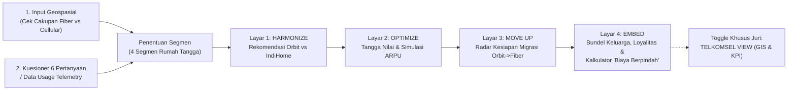

# Software & Prototype Proposal: "Home Ladder Navigator" (H.O.M.E.)
**Nama Prototype:** **Home Ladder Navigator — *Interactive Household Placement & Lifecycle Engine***  
**Sumber Konsep:** Sheet 2 Google Docs (*Prototype HOME*) + Penyempurnaan Data Geospasial, Telemetri & Loyalitas  
**File Terkait:**
- [Proposed_Solution.md](file:///home/brenandacaesa/PROJECT/DWDG/report/Proposed_Solution.md)
- [prototype_home_ladder_navigator.html](file:///home/brenandacaesa/PROJECT/DWDG/report/prototype_home_ladder_navigator.html) *(Prototipe Web Interaktif Siap Pakai)*

---

## 1. Ide Inti & Peran Prototype di Dalam Pitch Deck

**Home Ladder Navigator** adalah fitur cerdas (dapat diintegrasikan di dalam aplikasi **MyTelkomsel** / portal web akuisisi rumah tangga Telkomsel) yang menempatkan setiap rumah tangga di anak tangga **H.O.M.E.** yang tepat:
- **Data Geospasial Lokasi** menentukan **apa yang bisa dilayani** oleh infrastruktur Telkomsel di titik rumah tersebut (*Fiber-Ready* untuk IndiHome vs *Cellular-Only* untuk Orbit).
- **Kuesioner Singkat (untuk pelanggan baru) / Telemetri Pemakaian (untuk pelanggan lama)** menentukan **apa yang dibutuhkan** oleh rumah tangga tersebut (Segmen).
- Hasilnya ditindaklanjuti secara mulus melalui **4 Layar H.O.M.E. (*Harmonize $\to$ Optimize $\to$ Move Up $\to$ Embed*)** ditambah **1 Tampilan Bisnis (*Telkomsel View*)** untuk manajemen Telkomsel.

---

## 2. Spesifikasi 4 Layar Utama + 1 Layar Juri (*Telkomsel View*)

### Layar 1: **HARMONIZE** (*Geospasial Lokasi + Kuesioner 1 Menit*)

#### A. Lapisan Geospasial (*Opt-in Location & Coverage Map*)
- Pengguna menekan tombol **"Aktifkan Lokasi"** (atau memilih titik alamat pada peta skematis jika menolak izin GPS).
- Peta menampilkan dua lapisan infrastruktur:
  1. **Zona Hijau (*Fiber-Ready*):** Jaringan ODP IndiHome tersedia di lokasi rumah.
  2. **Zona Biru/Kuning (*Cellular-Only / Pre-Fiber*):** Belum terjangkau kabel fiber, namun terlayani jaringan 4G/5G Telkomsel Orbit.
- **Aturan Lokasi Pintar (*Geo-Override Rule*):** Jika hasil kuesioner menunjukkan segmen rumah tangga sebenarnya cocok memakai **IndiHome** (misal keluarga menetap dengan pemakaian tinggi), tetapi titik lokasinya **belum *fiber-ready***, maka sistem:
  1. Merekomendasikan **Orbit sekarang** agar rumah tangga langsung terlayani hari ini.
  2. Mengaktifkan fitur **"Kabari Saat Fiber Tersedia"** (otomatis mendaftarkan rumah tersebut ke antrean **Move Up**!).

#### B. Kuesioner 6 Pertanyaan Cepat (Mengukur 2 Sumbu Segmentasi)
| No | Pertanyaan pada Layar Navigator | Pilihan Jawaban | Dimensi yang Diukur |
| :-: | :--- | :--- | :--- |
| **1** | **Status hunian saat ini?** | Kos/Kontrak • Baru Pindah • Rumah Milik Sendiri | Sumbu 1: Fleksibilitas vs Stabilitas |
| **2** | **Rencana tinggal di lokasi ini?** | $<1\text{ tahun}$ • $1\text{–}3\text{ tahun}$ • $>3\text{ tahun}$ | Sumbu 1: Fleksibilitas vs Stabilitas |
| **3** | **Jumlah anggota rumah & perangkat terhubung?** | $1\text{–}2\text{ orang (1–3 alat)}$ • $3\text{–}4\text{ orang (4–7 alat)}$ • $\ge 5\text{ orang (8+ alat)}$ | Sumbu 2: Intensitas Digital |
| **4** | **Aktivitas internet utama di rumah?** | Sosmed/Browsing • Streaming Keluarga • Kerja/Belajar • Gaming/Konten | Sumbu 2: Intensitas Digital |
| **5** | **Seberapa kritis koneksi stabil tanpa jeda (video call/gaming)?** | Standar • Penting • Sangat Kritis (Wajib Stabil) | Sumbu 2: Intensitas Digital |
| **6** | **Layanan internet rumah yang dipakai sekarang?** | Belum Punya • Telkomsel Orbit • IndiHome | Titik Awal di Tangga H.O.M.E. |

#### C. Matriks Logika Segmentasi & Kartu Output Layar 1
| Sumbu Fleksibilitas \ Intensitas | Digital Rendah | Digital Sedang | Digital Tinggi |
| :--- | :---: | :---: | :---: |
| **Fleksibilitas Tinggi** *(Sewa / $<3\text{ thn}$ / Non-Fiber)* | **Flexible Starters** *(Produk: **Orbit**)* | **Flexible Growing Families** *(Produk: **Orbit $\to$ IndiHome**)* | **Flexible Growing Families** *(Produk: **Orbit $\to$ IndiHome**)* |
| **Stabilitas Tinggi** *(Milik Sendiri / $>3\text{ thn}$ / Fiber-Ready)* | **Stable Mainstream Families** *(Produk: **IndiHome**)* | **Stable Mainstream Families** *(Produk: **IndiHome**)* | **Performance Households** *(Produk: **IndiHome + Orbit Backup**)* |

---

### Layar 2: **OPTIMIZE** (*Tangga Nilai / Value Ladder*)
Menampilkan tangga peningkatan nilai yang disesuaikan dengan segmen pengguna (bukan katalog produk yang membingungkan):
1. **Anak Tangga Dasar — Konektivitas Saja (`Rp213.500 / bln`):** Internet rumah sesuai segmen.
2. **Anak Tangga Kedua — `+ Entertainment Bundle` (`Rp230.000 / bln` | `Uplift +Rp16.500`):** Ditawarkan karena sistem mendeteksi aktivitas *streaming* keluarga tinggi (mendapat akses paket OTT pilihan + *Tenure Loyalty Point*).
3. **Anak Tangga Ketiga — `+ Upgrade Speed / Gamer Tier` (`Rp250.000 / bln` | `Uplift +Rp36.500`):** Ditawarkan untuk rumah dengan banyak perangkat simultan atau kebutuhan *gaming/WFH* (*Higher Speed More Price* + bonus loyalitas kecepatan tahunan +10 Mbps).
- **Fitur Visual Penting:** Terdapat *live meter* **"ARPU Rumah Tangga"** yang bergerak naik dari `Rp213,5K` $\to$ `Rp230K` $\to$ `Rp250K`, membuktikan kepada juri bahwa kenaikan ARPU berasal dari **penambahan nilai (*value expansion*)**, bukan kenaikan harga dasar.

---

### Layar 3: **MOVE UP** (*Radar Kesiapan Migrasi Orbit $\to$ IndiHome*)
Khusus untuk segmen berbasis **Orbit** (*Flexible Starters* & *Flexible Growing Families*), layar ini menampilkan **3 Indikator Sinyal Migrasi**:
1. **Sinyal 1 — Status *Fiber-Ready*:** Diambil dari lapisan peta geospasial (Hijau = ODP IndiHome sudah tersedia di alamat rumah).
2. **Sinyal 2 — Intensitas Pemakaian (*Usage*):** Diambil dari kuesioner atau *slider* simulasi pemakaian bulanan (Hijau = pemakaian $>150\text{ GB/bulan}$ atau kuota sering habis).
3. **Sinyal 3 — Kesiapan Menetap:** Diambil dari profil hunian (Hijau = rencana tinggal $>1\text{ tahun}$).
- **Output Layar 3:** Jika ketiga sinyal menyala Hijau, muncul kartu **"Siap Naik Kelas ke IndiHome (FMC Bundle)"** dengan 3 jaminan bebas friksi:
  - *Gratis biaya pasang (hemat Rp500.000) & masa loyalitas Orbit ikut terbawa.*
  - *Internet Orbit tetap menyala sampai IndiHome selesai dipasang teknisi (Zero Downtime).*
  - *Tukar tambah (trade-in) modem Orbit satu pintu.*

---

### Layar 4: **EMBED** (*Ekosistem FMC Keluarga, Milestone `Bronze → Silver → Gold` & Kalkulator "Biaya Berpindah"*)
Layar ini menjawab secara konkret bagaimana ekosistem menahan *churn* melalui pendekatan **Milestone Tiering ala Shopee (`🥉 Bronze` $\to$ `🥈 Silver` $\to$ `🥇 Gold`)**:
- **Visual *Milestone Progress Bar*:** Menampilkan posisi kasta rumah tangga saat ini (**🥉 Bronze** di tahap *Harmonize*, **🥈 Silver** saat *Optimize/Move Up*, dan **🥇 Gold** saat mencapai *Embed* $\ge 3$ nomor keluarga) lengkap dengan indikator misi menuju level berikutnya.
- **Simulasi Jumlah Anggota Keluarga:** Pengguna menggeser *slider* jumlah nomor seluler Telkomsel anggota keluarga yang ditautkan (misal: 1 nomor = **🥉 Bronze**, 2 nomor = **🥈 Silver**, 3–5 nomor = **🥇 Gold**).
- **Rincian Benefit Bulanan Milestone 🥇 GOLD yang Terbuka (*Unlocked*):**
  1. **Kuota Keluarga Bersama (*Shared Family Quota*):** 30 GB/bulan (Senilai `Rp60.000/bln`).
  2. **Akses Hiburan Multi-Layar Keluarga:** OTT TV & HP (Senilai `Rp45.000/bln`).
  3. **Benefit Loyalitas Gold (*Speed Boost* +10 Mbps/thn & Teknisi VIP $<6\text{ jam}$):** (Senilai `Rp40.000/bln`).
- **Indikator Kunci — "Kalkulator Nilai yang Hilang Jika Turun Kasta / Pindah (*Switching Loss Meter*)":**
  - Menampilkan perbandingan terang-benderang: *"Jika keluarga Anda pindah ke kompetitor yang diskon Rp25.000/bulan, status **🥇 GOLD** Anda gugur dan keluarga Anda justru **kehilangan benefit senilai Rp145.000/bulan** (Rugi bersih Rp120.000/bulan)."*

---

### Mode Khusus Juri: **TELKOMSEL VIEW** (*B2B Executive Toggle*)
Satu tombol *toggle* di pojok kanan atas aplikasi yang mengubah tampilan dari sisi pelanggan (*Customer View*) menjadi **Dashboard Manajemen Telkomsel**:
- **Peta Sebaran Segmen & Zona *Migration-Ready*:** Menampilkan titik-titik rumah tangga pengguna Orbit yang kini berada di area *Fiber-Ready* (target langsung kampanye **Move Up**).
- **Funnel Konversi Move Up Terukur:** `Eligible (Memenuhi 3 Sinyal)` $\to$ `Dijangkau` $\to$ `Menerima Tawaran` $\to$ `Terpasang IndiHome`.
- **Ringkasan Dampak KPI Korporat:** Pergerakan ARPU (`Rp213,5K` $\to$ `Rp238,5K`), Penetrasi FMC (`59%` $\to$ `73%`), Target Migrasi (`450K`), dan Penurunan *Churn* (`-45 bps`).
