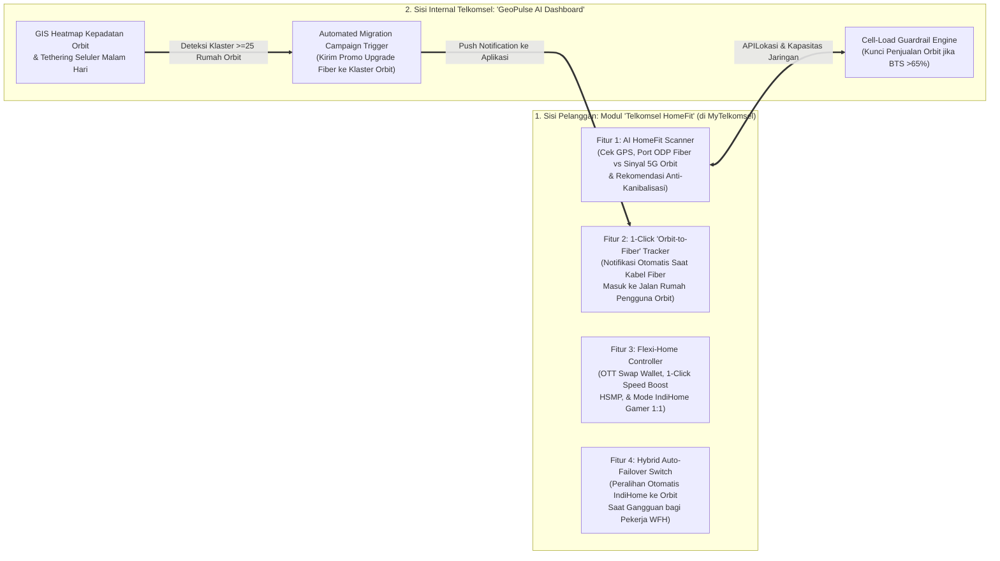

# Software & Digital Product Proposal: DWDG Mini Case Competition 2026
**Nama Inovasi Software:** **Telkomsel "HomeFit & GeoPulse" — *AI-Powered Household Connectivity Matchmaker, Lifecycle Manager & Migration Engine***  
**Terkait Langsung dengan:** [Proposed_Solution.md](file:///home/brenandacaesa/PROJECT/DWDG/report/Proposed_Solution.md)

---

## 1. Mengapa Kita Butuh Inovasi Software dalam Kasus Ini?

Dalam kasus **DWDG Mini Case Competition 2026**, masalah terbesar Telkomsel adalah:
1. **Di Sisi Pelanggan (*Customer Pain Point*):** Calon pelanggan bingung membedakan kapan harus memilih **IndiHome** vs **Telkomsel Orbit** (bahkan berisiko salah beli produk yang berujung kecewa atau kanibalisasi), sementara pelanggan lama IndiHome *Single-Play (1P)* merasa tidak punya kendali fleksibel atas paket hiburan/kecepatannya.
2. **Di Sisi Internal Telkomsel (*Operational Pain Point*):** Bagaimana Telkomsel tahu kapan sebuah klaster pengguna **Orbit** di daerah *non-fiber* sudah cukup padat untuk dibangunkan jaringan kabel **FTTH IndiHome** dan dimigrasikan secara otomatis?

Selaras dengan kapabilitas **Super-App MyTelkomsel** (Annual Report 2025 Hal. 64 & 84) dan inisiatif **Hitakari AI** (Annual Report 2025 Hal. 65), kami mengusulkan ekosistem perangkat lunak terintegrasi yang terdiri dari **2 komponen**:
1. **Modul *Customer-Facing* (Mini-App di dalam MyTelkomsel):** **"Telkomsel HomeFit"**
2. **Platform *Internal B2B/GIS Intelligence* (Untuk Tim Network & Commercial Telkomsel):** **"Telkomsel GeoPulse"**

---

## 2. Detail Fitur Komponen 1: "Telkomsel HomeFit" (*Customer-Facing App Module*)

Modul ini ditanamkan langsung di halaman utama kategori **"Internet Rumah"** pada aplikasi **MyTelkomsel** (sehingga tidak perlu mengunduh aplikasi terpisah yang meningkatkan biaya akuisisi aplikasi).

### Fitur A: *AI HomeFit Matchmaker* (Mencegah Kanibalisasi Sejak Hari Pertama)
Saat calon pelanggan membuka menu Internet Rumah, mereka tidak langsung disodori daftar harga yang membingungkan, melainkan **3 langkah interaktif selama 15 detik**:
1. **Pin Lokasi GPS Rumah:** Sistem langsung memindai 2 database secara *real-time*:
   - Ketersediaan *port* **ODP FTTH IndiHome** dalam radius $<150\text{ meter}$.
   - Kekuatan sinyal & sisa kapasitas (*cell load*) **BTS 4G/5G Telkomsel Orbit** di titik tersebut.
2. **3 Pertanyaan Profil Hunian (*Quick Quiz*):**
   - *Status Hunian:* "Milik Sendiri / Menetap $>1$ Tahun" vs "Sewa / Kos / Kontrakan / Sering Pindah".
   - *Jumlah Perangkat & Anggota Rumah:* "$1\text{–}3$ perangkat" vs "$4\text{–}8$ perangkat" vs "$>8$ perangkat".
   - *Aktivitas Utama:* "Browsing & Sosial Media", "Streaming Keluarga (TV & HP)", atau "Gaming Kompetitif / WFH Berat".
3. **Hasil Rekomendasi Presisi (*Smart Routing*):**
   - Jika hunian **Sewa/Kos** ATAU **ODP Fiber Penuh/Belum Ada** $\to$ Aplikasi mengarahkan ke **Telkomsel Orbit (Prabayar/Pascabayar)** dengan pengiriman modem instan.
   - Jika hunian **Menetap** DAN **ODP Fiber Tersedia** $\to$ Aplikasi mengarahkan ke **IndiHome Fiber** (lengkap dengan rekomendasi bundel *Multi-OTT* atau *IndiHome Gamer*).

### Fitur B: *1-Click "Orbit-to-Fiber Graduation" Tracker* (Mesin Migrasi Otomatis)
Bagi pelanggan yang saat ini menggunakan **Telkomsel Orbit** di area *Greenfield* (Segmen S2):
- Di dalam *dashboard* MyTelkomsel mereka terdapat kartu status: **"Status Jaringan Fiber di Area Anda"**.
- Begitu TelkomGroup selesai memasang jaringan ODP FTTH IndiHome di jalan rumah mereka, status berubah menjadi hijau dan memunculkan penawaran eksklusif:
  > *"Selamat! Jaringan Fiber Optik IndiHome kini telah hadir di depan rumah Anda. Tukar tambah modem Orbit Anda ke IndiHome Fiber hari ini: **Gratis Biaya Pasang + Bonus Kecepatan 2x Lipat selama 3 Bulan!**"*
- Pelanggan cukup menekan **1 tombol** untuk memilih jadwal kedatangan teknisi.

### Fitur C: *Flexi-Home & ARPU Booster Wallet* (Mesin Peningkatan ARPU Tanpa Perang Harga)
Dirancang khusus untuk mengubah pelanggan IndiHome *Single-Play (1P)* menjadi pelanggan bernilai tinggi:
1. **"OTT Swap Wallet" (*Multi-OTT Flexi Pass*):** Pelanggan cukup membayar ekstra Rp40.000/bulan untuk mendapatkan **3 Slot Token OTT**. Melalui *slider* di aplikasi, mereka bisa memilih sendiri 3 aplikasi (misal bulan ini: *Netflix + Vidio + Viu*; kuartal depan saat musim sepak bola diganti ke *Vision+ + Vidio + Prime Video*) tanpa perlu menghubungi *call center*.
2. **"Smart Traffic Alert & 1-Click Speed Boost" (Kontekstual HSMP):**
   - Aplikasi menampilkan grafik penggunaan *bandwidth* rumah dan daftar perangkat yang sedang terhubung.
   - Saat jaringan rumah terdeteksi padat di malam hari, muncul tombol **"Boost Kecepatan ke 100 Mbps Malam Ini (Rp10.000)"** atau **"Upgrade Permanen HSMP (+Rp30.000/bln)"**.
3. **"Gamer Mode Toggle" (1:1 Symmetrical Switch):** Pelanggan dapat menjadwalkan atau mengaktifkan profil *IndiHome Gamer* (rasio *upload:download* simetris 1:1 dan *low-latency routing*).

### Fitur D: *Dual-Connection Auto-Failover Manager* (Untuk Segmen S4: WFH & Prosumer)
Bagi pelanggan paket hibrida **"IndiHome Pro + Orbit Backup"**:
- Aplikasi menampilkan indikator ganda: **Primary Line (IndiHome Fiber: Online)** dan **Backup Line (Orbit 5G: Standby)**.
- Jika kabel fiber terputus atau mengalami gangguan massal, *gateway* rumah otomatis memindahkan koneksi ke jaringan seluler **Orbit** dalam $<3\text{ detik}$, dan aplikasi mengirimkan notifikasi: *"Koneksi Fiber sedang dalam pemulihan. Rumah Anda otomatis terhubung melalui Orbit Backup tanpa putus."*

---

## 3. Detail Fitur Komponen 2: "Telkomsel GeoPulse" (*Internal GIS & AI Dashboard*)

Merupakan *web dashboard* internal berbasis **Hitakari AI** untuk tim *Network Planning* dan *Household Commercial* Telkomsel:
1. **Peta Panas Klaster Orbit & Tethering (*Micro-Area Heatmap*):**
   - Memvisualisasikan konsentrasi pengguna **Orbit aktif** dan pengguna seluler Telkomsel dengan trafik *tethering* malam hari $>100\text{ GB/bulan}$ di seluruh Indonesia hingga level Kelurahan/RW.
2. **Indikator Kelayakan Investasi Fiber (*De-Risked FTTH CapEx Trigger*):**
   - Alih-alih membangun jaringan kabel FTTH secara spekulatif (yang berisiko sepi peminat), sistem memberi skor prioritas pembangunan ODP baru di RW yang sudah memiliki **$\ge 25$ pelanggan aktif Orbit**. Begitu ODP dibangun, pelanggan Orbit di klaster tersebut langsung siap dimigrasikan (*instant take-up rate*).
3. **Pengaman Beban BTS (*Dynamic Cell-Load Guardrail*):**
   - Memantau beban trafik seluruh 293.136 BTS. Jika sebuah BTS mencapai utilisasi $>65\%$ pada jam sibuk (19.00–22.00), sistem otomatis menonaktifkan kuota promo akuisisi Orbit baru di titik koordinat tersebut dan mengalihkan tim *sales* lapangan untuk menjual **IndiHome Fiber**.

---

## 4. Arsitektur Teknis & Kemudahan Implementasi (*Feasibility*)

Mengapa ide software ini sangat realistis (*commercially & operationally feasible*) bagi Telkomsel?
- **Tidak Membangun dari Nol:** Memanfaatkan fondasi **Super-App MyTelkomsel** (yang sudah digunakan puluhan juta pengguna dan pada 2025 telah merombak *dashboard* & sistem *billing* terpadu IndiHome + Seluler, AR Hal. 84) serta **AI Broadband Network Gateway** (AR Hal. 19) dan **Hitakari AI** (AR Hal. 65).
- **Integrasi API Eksisting:** Hanya membutuhkan penyatuan lapisan data ketersediaan *port* ODP (milik Telkom Infra/IndiHome) dengan data *cell-load* BTS & lokasi pelanggan Orbit dalam satu *microservice engine*.

| Komponen Sistem | Teknologi / Aset Eksisting Telkomsel (AR 2025) | Fungsi Baru yang Ditambahkan |
| :--- | :--- | :--- |
| **Frontend Pelanggan** | **Super-App MyTelkomsel** (iOS / Android / Web) | Modul UI/UX **HomeFit Scanner**, **OTT Swap Wallet**, & **Orbit-to-Fiber Tracker**. |
| **AI & Analytics Layer** | **Hitakari AI** & *Customer Value Management (CVM)* | Algoritma pencocokan produk mikro-area & pemicu *upselling* kontekstual (HSMP). |
| **Network Control Layer** | **AI Broadband Network Gateway** & *Autonomous Network* (80% jaringan IndiHome & 76% BTS, AR Hal. 18) | Pemantauan *cell-load* BTS (<65%) dan *auto-failover* ONT IndiHome $\leftrightarrow$ Modem Orbit. |

> [!TIP]
> **Opsi Tambahan untuk Presentasi / Demo Lomba:**  
> Jika kamu ingin menampilkan **mockup / prototipe interaktif aplikasi "Telkomsel HomeFit & GeoPulse"** di dalam *slide deck* atau mendemokannya di depan juri, kita bisa langsung membuatkan aplikasi prototipe berbasis Web/HTML interaktif di dalam folder `./figure/` atau `./report/`!
