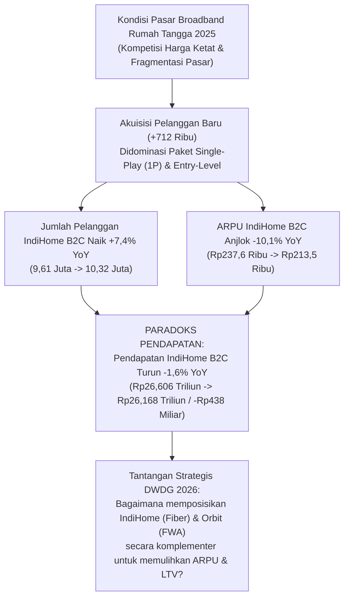
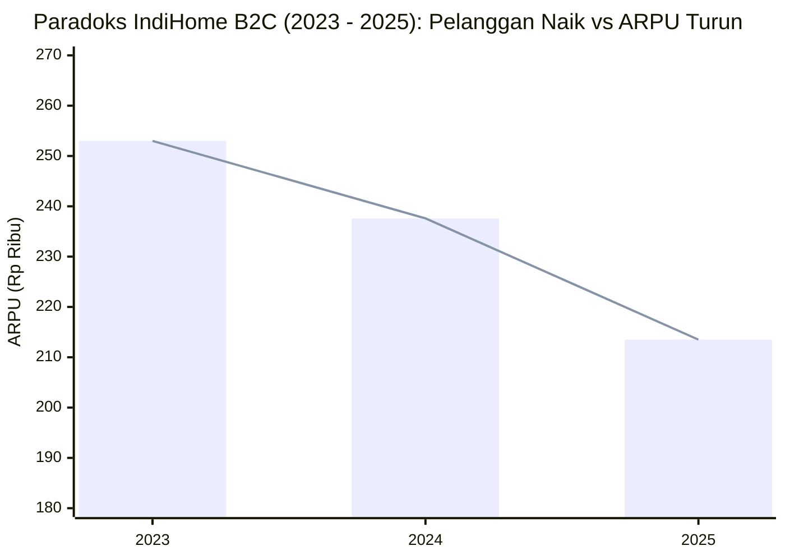
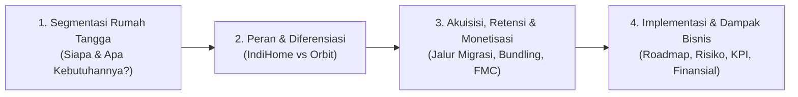

# Bedah Data & Diagnosis Masalah: DWDG Mini Case Competition 2026
**Topik Kasus:** *Connecting Every Home: Optimizing Telkomsel’s Household Connectivity Portfolio*  
**Sumber Referensi:**
- [DWDG Mini Case Competitoin Case.pdf](../references/DWDG%20Mini%20Case%20Competitoin%20Case.pdf)
- [Annual-Report-Telkomsel-2025-web-ID.pdf](../references/Annual-Report-Telkomsel-2025-web-ID.pdf)

---

## 1. Inti Permasalahan (*The Core Problem: Volume vs. Value Paradox*)

Pada tahun 2025, bisnis konektivitas rumah tangga (*Household Connectivity*) Telkomsel mengalami **paradoks pertumbuhan**: jumlah pelanggan rumah tangga terus bertambah secara signifikan, namun nilai uang yang dihasilkan per rumah tangga (**ARPU**) turun lebih dalam sehingga **total pendapatan segmen rumah tangga justru menyusut**.

> [!IMPORTANT]
> **Pertanyaan Kunci Lomba (Key Question):**  
> *"Seiring kebutuhan konektivitas rumah tangga yang semakin beragam, bagaimana Telkomsel harus **mendiferensiasikan dan memposisikan IndiHome serta Orbit** di berbagai segmen pelanggan untuk membuka nilai jangka panjang yang lebih kuat **tanpa bergantung terutama pada perang harga**?"*

---

## 2. Tabel Data Lengkap dari Annual Report Telkomsel 2025

Berikut adalah rangkuman angka resmi dari **Laporan Tahunan Telkomsel 2025** (Halaman 7–11 dan 156–158) yang wajib menjadi fondasi argumen kuantitatif tim kamu:

### A. Kinerja Segmen Rumah Tangga (IndiHome B2C & FMC)

| Indikator Utama | FY 2023 | FY 2024 | FY 2025 | Perubahan YoY (2024–2025) | Referensi Halaman AR 2025 |
| :--- | :---: | :---: | :---: | :---: | :---: |
| **Pelanggan IndiHome B2C** | 8,694 Juta | 9,612 Juta | **10,324 Juta** | **+7,4%** (+712 ribu *net add*) | Hal. 9, 11, 86, 156 |
| **ARPU IndiHome B2C** | Rp253,0 ribu | Rp237,6 ribu | **Rp213,5 ribu** | **-10,1%** (-Rp24,1 ribu/bln) | Hal. 11, 156, 157 |
| **Pendapatan IndiHome B2C** | Rp13.227 M* | Rp26.606 M | **Rp26.168 M** | **-1,6%** (-Rp438 miliar) | Hal. 10, 157 |
| **Penetrasi Konvergensi (FMC)** | ~50% | ~57% | **59%** | **+2 ppt** (>7% pertumbuhan sub FMC) | Hal. 7, 63, 66, 86 |
| **Estimasi Rumah Tangga FMC** | ~4,35 Juta | ~5,48 Juta | **~6,09 Juta** | **~4,23 Juta FBB belum FMC (41%)** | Kalkulasi Basis 10,324 Jt |

*\*Catatan: Pendapatan IndiHome B2C 2023 hanya dikonsolidasikan separuh tahun pasca-integrasi FMC Juli 2023.*

### B. Kinerja Korporat, Seluler & Infrastruktur Telkomsel (Konteks Ekosistem)

| Indikator Korporat & Jaringan | FY 2024 | FY 2025 | Perubahan YoY | Implikasi Strategis untuk Kasus Rumah Tangga |
| :--- | :---: | :---: | :---: | :--- |
| **Total Pendapatan Telkomsel** | Rp113.340 M | **Rp109.307 M** | -3,6% | IndiHome B2C menyumbang **23,9%** dari total pendapatan Telkomsel. |
| **Pendapatan Bisnis Digital (Seluler)** | Rp78.286 M | **Rp76.805 M** | -1,9% | Menyumbang **92,4%** pendapatan seluler (naik dari 90,3% di 2024). |
| **Pendapatan Legacy (Voice/SMS)** | Rp8.447 M | **Rp6.334 M** | -25,0% | Penurunan struktural; memaksa monetisasi datang dari data & rumah tangga. |
| **EBITDA & Margin EBITDA** | Rp51.337 M (45,3%) | **Rp49.624 M (45,4%)** | -3,3% (+0,1ppt) | Margin sangat sehat (45,4%) berkat efisiensi biaya (-3,7% OpEx) & sinergi TelkomGroup. |
| **Pelanggan Seluler** | 159,39 Juta | **156,06 Juta** | -2,1% | Basis masif untuk *cross-selling* Orbit & konversi Telkomsel One (FMC). |
| **ARPU Seluler** | Rp44 ribu | **Rp43 ribu** | -2,3% | Membaik di Semester II-2025 (+5,1% QoQ di Q3 & +2,4% QoQ di Q4). |
| **Data Payload / Traffic** | 20,39 Juta TB | **23,44 Juta TB** | **+15,0%** | Konsumsi data melonjak 15% (22.895 Petabyte), bukti kebutuhan kuota rumah tinggi. |
| **Total BTS (3G/4G/5G)** | 271.040 (222.265) | **293.136 (244.501)** | **+8,2%** (+10,0%) | Termasuk **~5.000 BTS 5G di 80 kota** — tulang punggung **Telkomsel Orbit**! |

---

## 3. Temuan Emas (*Hidden Gems*) di Annual Report 2025 yang Jarang Disadari Peserta Lain

Jika peserta lain hanya membaca *casebook* 4 halaman, mereka hanya tahu "IndiHome = Fiber" dan "Orbit = Wireless". Dari hasil bedah **Annual Report Telkomsel 2025 (Halaman 63–66 dan 81–86)**, terdapat **4 fakta strategis** yang sudah dijalankan Telkomsel dan bisa kita jadikan senjata utama solusi:

1. **Arsitektur 3-Lapis yang Sebenarnya (IndiHome + Orbit + EZnet):**
   - Di Halaman 63, 81–82, dan 86 dijelaskan bahwa Telkomsel telah meluncurkan **EZnet** (fiber *entry-level*) dan **EZnet Wireless** (*Unlimited* dengan FUP + skema sewa perangkat / *bring-your-own-device*) untuk menghadapi perang harga di segmen *mass-market* yang sensitif harga.
   - **Artinya:** IndiHome dan Orbit **tidak boleh** ditarik turun ke perang harga murah, karena fungsi pertahanan harga bawah sudah dijaga oleh lini *entry-level*. IndiHome dan Orbit harus fokus pada **diferensiasi nilai & kualitas pengalaman**.
2. **Senjata Monetisasi Baru IndiHome di 2025 (Halaman 82 & 85):**
   - **IndiHome Gamer:** Diluncurkan akhir 2025 dengan kecepatan *upload* dan *download* simetris (1:1) plus *benefit* *gaming* di ekosistem Dunia Games.
   - **Program HSMP (*Higher Speed More Price*) & *Early Payment*:** Program *upselling* kecepatan untuk menaikkan ARPU dan menekan *churn* lewat insentif pembayaran lebih awal.
   - **Multi-OTT Soft Bundle & *Set-Top Box (STB) Takeover*:** Mengubah pelanggan *Single-Play (1P)* menjadi *Dual-Play (2P)* / *Triple-Play (3P)* melalui paket *streaming* terpadu (Vidio, iQIYI, Viu, WeTV, Vision+ Premium, Prime Video, Netflix, Disney+, Max).
3. **Revamp Nasional Telkomsel Orbit (Halaman 82 & 86):**
   - Pada 2025, paket Orbit disederhanakan secara nasional (termasuk penyesuaian PPN) dengan opsi **Prabayar (Prepaid)** dan **Pascabayar (Postpaid)**.
   - Orbit berperan ganda: **(a) Solusi *Greenfield*** di wilayah yang belum terjangkau jaringan *fiber* (FTTH), dan **(b) Solusi Fleksibilitas/Mobilitas** bagi rumah tangga non-permanen (perantau, penghuni kos/apartemen sewa, pekerja proyek/komuter).
4. **Telkomsel One & Super-App MyTelkomsel (Halaman 64, 66, 82, 86):**
   - Pada 2025, Telkomsel One diperbarui dengan **Personal Plan & Family Plan** serta integrasi penuh ke **MyTelkomsel** (yang kini mengintegrasikan IndiHome, Orbit, dan Seluler Halo+/SIMPATI dalam satu *dashboard* & satu tagihan).
   - Penetrasi konvergensi saat ini **59%** dari basis FBB (~6,09 juta pelanggan). Artinya masih ada **41% (~4,23 juta rumah tangga IndiHome)** yang **belum** terintegrasi penuh ke paket konvergensi multi-produk, ditambah puluhan juta rumah tangga pengguna seluler Telkomsel yang belum memakai internet rumah Telkomsel!

---

## 4. Pemetaan Masalah ke 4 Pertanyaan Lomba (DWDG Case Scope)

| Pertanyaan di Casebook DWDG | Akar Masalah Saat Ini (Data 2025) | Arah Strategi yang Diharapkan Juri |
| :--- | :--- | :--- |
| **Q1. Segmentasi Rumah Tangga Prioritas** | Pelanggan rumah tangga diperlakukan seragam sehingga banyak yang memilih paket 1P termurah. | Membagi segmen rumah tangga berdasarkan **2 dimensi utama**: (1) *Stabilitas Hunian & Kesiapan Jaringan* (Menetap/Fiber-Ready vs Dinamis/Non-Fiber), dan (2) *Intensitas Digital & Daya Beli* (Basic/Entry, Family Entertainment, Prosumer/Gamer/WFH). |
| **Q2. Peran IndiHome vs Orbit** | Risiko kanibalisasi jika Orbit dan IndiHome dijual ke target yang sama sebagai barang substitusi. | **Bukan substitusi, melainkan komplementer & berjenjang:** • **Orbit:** *Acquisition Spearhead & Flexible Broadband* (hunian sewa/dinamis, area *non-fiber port*, pemakaian musiman/prabayar). • **IndiHome:** *High-Capacity Digital Home Anchor* (keluarga menetap, penggunaan berat/simetris, multi-layar IPTV/OTT). |
| **Q3. Akuisisi, Retensi & Peningkatan Nilai (ARPU/LTV)** | ARPU turun -10,1% (ke Rp213,5rb) karena proporsi 1P membesar dan perang harga. | • **Jalur Migrasi (*Graduation Pathway*):** *Orbit Prepaid $\to$ Orbit Postpaid $\to$ IndiHome Fiber $\to$ Telkomsel One Family*. • **Upgrading 1P ke 2P/3P & Niche Tier:** *STB Takeover*, *Multi-OTT*, *IndiHome Gamer*, & *HSMP*. • **FMC Lock-in:** Menaikkan penetrasi FMC dari 59% ke >70% lewat *Family Quota Sharing* di MyTelkomsel. |
| **Q4. Implementasi, KPI & Estimasi Dampak Bisnis** | Pertumbuhan pelanggan +7,4% gagal menjadi pertumbuhan pendapatan (-1,6%). | • **Roadmap Bertahap** (Quick Wins Q1-Q2, Scale-Up Q3-Q4, Ecosystem Maturity Tahun 2). • **Kalkulasi Dampak:** Setiap kenaikan ARPU **+Rp10.000** pada basis 10,32 juta pelanggan = **+Rp1,24 Triliun pendapatan baru per tahun** tanpa perlu perang harga! |
